<!--
author:   Evan Czaplicki
version:  1.0.0
language: en
narrator: US English Female
comment:  The official Elm guide "An Introduction to Elm" by Evan Czaplicki,
          converted to LiaScript – text unchanged, examples runnable in the browser.

import:   https://raw.githubusercontent.com/LiaTemplates/elm-guida/0.0.2/README.md

link:     https://fonts.googleapis.com/css2?family=IBM+Plex+Sans:ital,wght@0,400;0,600;1,400&family=Source+Code+Pro:wght@400;600&display=swap

@style
/* ==== liascript-theming:start ==== */
/* links: https://fonts.googleapis.com/css2?family=IBM+Plex+Sans:ital,wght@0,400;0,600;1,400&family=Source+Code+Pro:wght@400;600&display=swap */
/* theme: Elm Guide (after elm-lang.org) — generated by liascript-theming, edit theme.json and rebuild */
:root {
  --theme-font-body: 'IBM Plex Sans', sans-serif;
  --theme-font-heading: 'IBM Plex Sans', serif;
  --theme-font-mono: 'Source Code Pro', monospace;
  --theme-font-quote: 'IBM Plex Sans', serif;
  --theme-heading-weight: 400;
  --theme-line-height: 1.5;
  --theme-radius: 0;
  --theme-radius-small: 0.3rem;
  --theme-radius-large: 0.6rem;
  --theme-shadow: none;
}
/* surfaces & text: apply to every color theme */
:root.lia-variant-light {
  --color-background: 255,255,255;
  --color-text: 0,14,22;
  --color-border: 205,205,205;
  --lia-grey-lighter: 240,240,240;
  --lia-grey-light: 227,241,250;
}
:root.lia-variant-dark {
  --color-background: 21,30,35;
  --color-text: 229,233,235;
  --color-border: 49,65,73;
  --lia-grey-dark: 30,41,47;
  --lia-anthracite: 41,54,61;
}
/* accent: only the course theme (default) and the custom radio,
   so readers can still pick LiaScript's built-in color themes;
   --color-accent = accent as text and border: links, active
   TOC entry, form borders; LiaScript would brighten it x2.5 in dark mode */
:root:is(.lia-theme-default, .lia-theme-custom) {
  --color-highlight: 15,125,183;
  --color-highlight-dark: 15,125,183;
  --color-accent: rgb(15,125,183);
}
:root.lia-theme-default {
  --color-highlight-menu: 15,125,183;
}
:root:is(.lia-theme-default, .lia-theme-custom).lia-variant-dark {
  --color-highlight: 15,125,183;
  --color-highlight-dark: 76,183,240;
  --color-accent: rgb(76,183,240);
}
/* notes and TTS bar set their own --color-accent on surface_strong in dark mode */
:root:is(.lia-theme-default, .lia-theme-custom).lia-variant-dark :is(.lia-notes, .lia-responsive-voice) {
  --color-accent: rgb(76,183,240);
}
/* ==== LiaScript theme adapter (liascript-theming) — keep verbatim ====
   Maps the --theme-* tokens onto LiaScript's CSS. Everything a theme
   changes lives in the token block above this one. */

/* -- fonts: body/mono via the global variables, headings & co. are
      compiled literals in LiaScript and need explicit selectors -- */
:root {
  --global-font-family: var(--theme-font-body);
  --global-font-mono: var(--theme-font-mono);
  --global-font-headline: var(--theme-font-heading);
}
body { line-height: var(--theme-line-height, 1.47); }
h1, h2, h3, .h1, .h2, .h3 {
  font-family: var(--theme-font-heading);
  font-weight: var(--theme-heading-weight, 600);
  letter-spacing: var(--theme-heading-letter-spacing, normal);
  text-transform: var(--theme-heading-transform, none);
  color: var(--theme-heading-color, inherit);
}
h4, h5, h6, .h4, .h5, summary, .lia-accordion__headline {
  font-family: var(--theme-font-subheading, var(--theme-font-body));
}
.lia-quote__text { font-family: var(--theme-font-quote, var(--theme-font-heading)); }
.lia-code, .lia-code--inline, code, kbd, samp, pre { font-family: var(--theme-font-mono); }
.lia-code .ace_editor { font-family: var(--theme-font-mono) !important; }

/* -- shape: radius for controls & surfaces (radio buttons, tags, circles stay) -- */
:is(button, .lia-btn, input, .lia-input, select, .lia-select, textarea, .lia-textarea, .lia-dropdown):not(.lia-radio, .lia-btn--tag, .lia-btn--small-tag),
.lia-code-terminal__input, .lia-pagination__content, .lia-script, .lia-support-menu__submenu {
  border-radius: var(--theme-radius);
}
.lia-checkbox[type='checkbox'], kbd, .lia-tooltip .lia-tooltiptext, .lia-code--inline {
  border-radius: var(--theme-radius-small);
}
details, .lia-quote, .lia-code__input, .lia-table-responsive, .lia-card {
  border-radius: var(--theme-radius-large);
  box-shadow: var(--theme-shadow);
}
.lia-quote, .lia-code__input { overflow: hidden; }
.lia-code__input .ace_editor { border-radius: inherit; }
.lia-support-menu__submenu { box-shadow: var(--theme-shadow-popup, 0 0 1rem rgba(128, 128, 128, 0.2)); }

/* -- dark mode: LiaScript brightens the accent by multiplying RGB
      (rgb(from … calc(r*2.5))), which turns a hand-picked accent into
      pastel/yellow. Links, inline code text, the active TOC entry and
      form borders read --color-accent, which the token block sets; the
      rules below cover what is still multiplied.
      Scoped to default/custom so the built-in color themes keep their
      behavior. -- */
:root:is(.lia-theme-default, .lia-theme-custom).lia-variant-dark :is(.lia-link, .lia-btn--outline, .lia-code--inline) {
  color: rgb(var(--color-highlight-dark));
  border-color: rgb(var(--color-highlight-dark));
}
:root:is(.lia-theme-default, .lia-theme-custom).lia-variant-dark :is(summary, summary:after, .lia-label, .lia-skip-nav, .lia-support-menu__item, .lia-quote__text),
:root:is(.lia-theme-default, .lia-theme-custom).lia-variant-dark :is(.lia-list--unordered, .lia-list--ordered) > li::marker {
  color: rgb(var(--color-highlight-dark));
}
/* .lia-btn--transparent: brightness filter */
:root:is(.lia-theme-default, .lia-theme-custom).lia-variant-dark .lia-btn--transparent {
  filter: none;
}
/* hidden navigation: icon buttons float on the page; without the
   brightness filter above they need the accent as text */
:root:is(.lia-theme-default, .lia-theme-custom).lia-variant-dark .lia-navigation--hidden :is(#lia-btn-toc, #lia-btn-prev, #lia-btn-next, #lia-btn-sound, .lia-support-menu__item > button, .lia-support-menu__item > a.lia-btn) {
  color: rgb(var(--color-highlight-dark));
}
/* TOC separators use the light palette grey in every mode (glaring in dark mode);
   follow the theme border instead */
:root .lia-toc__content a.lia-toc__link--is-lvl-2::after,
:root .lia-toc__bottom::after {
  background-color: rgb(var(--color-border));
}
/* alternating table rows: LiaScript uses a neutral grey in dark mode;
   survey matrices render the row statements as th */
:root.lia-variant-dark .lia-table.is-alternating .lia-table__row:nth-child(2n) :is(td, th) {
  background-color: rgb(var(--lia-grey-dark));
}
/* sticky first/last column: a gradient on top, hence the shorthand */
:root.lia-variant-dark .lia-table-responsive.has-thead-sticky.has-first-col-sticky .is-alternating .lia-table__row:nth-child(2n) :is(td, th):first-child:before,
:root.lia-variant-dark .lia-table-responsive.has-thead-sticky.has-last-col-sticky .is-alternating .lia-table__row:nth-child(2n) :is(td, th):last-child:before {
  background: rgb(var(--lia-grey-dark));
}
/* -- layout / density / motion features -- */
.lia-canvas.lia-mode--textbook .lia-slide__content { max-width: 72ch; margin-inline: auto; }
/* -- theme extras -- */
.lia-btn:not(.lia-btn--transparent):not(.lia-btn--tag):not(.lia-btn--small-tag) { box-shadow: 0.4rem 0.4rem 0 #95C9EC; }
:root.lia-variant-dark .lia-btn:not(.lia-btn--transparent):not(.lia-btn--tag):not(.lia-btn--small-tag) { box-shadow: 0.4rem 0.4rem 0 rgba(18,147,216,.45); }
.lia-quote:not([class*='alert']) { background-color: #F5FBFF; border-radius: 0.6rem; }
.lia-quote:not([class*='alert']) .lia-quote__text { color: #00263C; }
:root.lia-variant-dark .lia-quote:not([class*='alert']) { background-color: rgba(18,147,216,.12); }
:root.lia-variant-dark .lia-quote:not([class*='alert']) .lia-quote__text { color: rgb(var(--color-text)); }
.lia-slide__content h1.h1, .lia-slide__content h2.h1 { border-bottom: 0.3rem solid #95C9EC; padding-bottom: 0.4rem; }
:root.lia-variant-dark .lia-slide__content img { background-color: #ffffff; border-radius: 0.6rem; padding: 0.8rem; }
/* ==== liascript-theming:end ==== */
@end

@custom
--color-highlight-menu: 255,255,255;
@end
-->

# An Introduction to Elm

**Elm is a functional language that compiles to JavaScript.** It helps you make websites and web apps. It has a strong emphasis on simplicity and quality tooling.

This guide will:

- Teach you the fundamentals of programming in Elm.
- Show you how to make interactive apps with **The Elm Architecture**.
- Emphasize principles and patterns that generalize to programming in any language.

By the end I hope you will not only be able to create great web apps in Elm, but also understand the core ideas and patterns that make Elm nice to use.

If you are on the fence, I can safely guarantee that if you give Elm a shot and actually make a project in it, you will end up writing better JavaScript code. The ideas transfer pretty easily!


## A Quick Sample

Here is a little program that lets you increment and decrement a number:

```elm
import Browser
import Html exposing (Html, button, div, text)
import Html.Events exposing (onClick)

main =
  Browser.sandbox { init = 0, update = update, view = view }

type Msg = Increment | Decrement

update msg model =
  case msg of
    Increment ->
      model + 1

    Decrement ->
      model - 1

view model =
  div []
    [ button [ onClick Decrement ] [ text "-" ]
    , div [] [ text (String.fromInt model) ]
    , button [ onClick Increment ] [ text "+" ]
    ]
```
@Elm.eval

Try it out in the online editor [here](https://elm-lang.org/examples/buttons).

The code can definitely look unfamiliar at first, so we will get into how this example works soon!


## Why a functional *language*?

You can get some benefits from programming in a functional *style*, but there are some things you can only get from a functional *language* like Elm:

- No runtime errors in practice.
- Friendly error messages.
- Reliable refactoring.
- Automatically enforced semantic versioning for all Elm packages.

No combination of JS libraries can give you all of these guarantees. They come from the design of the language itself! And thanks to these guarantees, it is quite common for Elm programmers to say they never felt so **confident** while programming. Confident to add features quickly. Confident to refactor thousands of lines. But without the background anxiety that you missed something important!

I have put a huge emphasis on making Elm easy to learn and use, so all I ask is that you give Elm a shot and see what you think. I hope you will be pleasantly surprised!


## Core Language

Let's start by getting a feeling for Elm code!

The goal here is to become familiar with **values** and **functions** so you will be more confident reading Elm code when we get to the larger examples later on.


### Values

The smallest building block in Elm is called a **value**. This includes things like `42`, `True`, and `"Hello!"`.

Let's start by looking at numbers:

```elm
1 + 1
```
@Elm.repl

All the examples on this page are interactive, so click on this black box ⬆️ and the cursor should start blinking. Type in `2 + 2` and press the ENTER key. It should print out `4`. You should be able to interact with any of the examples on this page the same way!

Try typing in things like `30 * 60 * 1000` and `2 ^ 4`. It should work just like a calculator!

Doing math is fine and all, but it is surprisingly uncommon in most programs! It is much more common to work with **strings** like this:

```elm
"hello"

"butter" ++ "fly"
```
@Elm.repl

Try putting some strings together with the `(++)` operator ⬆️

These primitive values get more interesting when we start writing functions to transform them!

> **Note:** You can learn more about operators like [`(+)`](https://package.elm-lang.org/packages/elm/core/latest/Basics#+) and [`(/)`](https://package.elm-lang.org/packages/elm/core/latest/Basics#/) and [`(++)`](https://package.elm-lang.org/packages/elm/core/latest/Basics#++) in the documentation for the [`Basics`](https://package.elm-lang.org/packages/elm/core/latest/Basics) module. It is worth reading through all the docs in that package at some point!


### Functions

A **function** is a way to transform values. Take in one value, and produce another.

For example, here is a `greet` function that takes in a name and says hello:

```elm
greet name =
  "Hello " ++ name ++ "!"

greet "Alice"

greet "Bob"
```
@Elm.repl

Try greeting someone else, like `"Stokely"` or `"Kwame"` ⬆️

The values passed in to the function are commonly called **arguments**, so you could say "`greet` is a function that takes one argument."

Okay, now that greetings are out of the way, how about a `madlib` function that takes _two_ arguments?

```elm
madlib animal adjective =
  "The ostentatious " ++ animal ++ " wears " ++ adjective ++ " shorts."

madlib "cat" "ergonomic"

madlib ("butter" ++ "fly") "metallic"
```
@Elm.repl

Try giving two arguments to the `madlib` function ⬆️

Notice how we used parentheses to group `"butter" ++ "fly"` together in the second example. Each argument needs to be a primitive value like `"cat"` or it needs to be in parentheses!

> **Note:** People coming from languages like JavaScript may be surprised that functions look different here:
>
>     madlib "cat" "ergonomic"                  -- Elm
>     madlib("cat", "ergonomic")                // JavaScript
>
>     madlib ("butter" ++ "fly") "metallic"      -- Elm
>     madlib("butter" + "fly", "metallic")       // JavaScript
>
> This can be surprising at first, but this style ends up using fewer parentheses and commas. It makes the language feel really clean and minimal once you get used to it!


### If Expressions

When you want to have conditional behavior in Elm, you use an if-expression.

Let's make a new `greet` function that is appropriately respectful to president Abraham Lincoln:

```elm
greet name =
  if name == "Abraham Lincoln" then
    "Greetings Mr. President!"
  else
    "Hey!"

greet "Tom"

greet "Abraham Lincoln"
```
@Elm.repl

There are probably other cases to cover, but that will do for now!


### Lists

Lists are one of the most common data structures in Elm. They hold a sequence of related things, similar to arrays in JavaScript.

Lists can hold many values. Those values must all have the same type. Here are a few examples that use functions from the [`List`](https://package.elm-lang.org/packages/elm/core/latest/List) module:

```elm
names =
  [ "Alice", "Bob", "Chuck" ]

List.isEmpty names

List.length names

List.reverse names

numbers =
  [4,3,2,1]

List.sort numbers

increment n =
  n + 1

List.map increment numbers
```
@Elm.repl

Try making your own list and using functions like `List.length` ⬆️

And remember, all elements of the list must have the same type!


### Tuples

Tuples are another useful data structure. A tuple can hold two or three values, and each value can have any type. A common use is if you need to return more than one value from a function. The following function gets a name and gives a message for the user:

```elm
isGoodName name =
  if String.length name <= 20 then
    (True, "name accepted!")
  else
    (False, "name was too long; please limit it to 20 characters")

isGoodName "Tom"
```
@Elm.repl

This can be quite handy, but when things start becoming more complicated, it is often best to use records instead of tuples.


### Records

A **record** can hold many values, and each value is associated with a name.

Here is a record that represents British economist John A. Hobson:

```elm
john =
  { first = "John"
  , last = "Hobson"
  , age = 81
  }

john.last
```
@Elm.repl

We defined a record with three **fields** containing information about John's name and age.

Try accessing other fields like `john.age` ⬆️

You can also access record fields by using a "field access function" like this:

```elm
john = { first = "John", last = "Hobson", age = 81 }

.last john

List.map .last [john,john,john]
```
@Elm.repl

It is often useful to **update** values in a record:

```elm
john = { first = "John", last = "Hobson", age = 81 }

{ john | last = "Adams" }

{ john | age = 22 }
```
@Elm.repl

If you wanted to say these expressions out loud, you would say something like, "I want a new version of John where his last name is Adams" or "john where the age is 22".

Notice that when we update some fields of `john` we create a whole new record. It does not overwrite the existing one. Elm makes this efficient by sharing as much content as possible. If you update one of ten fields, the new record will share the nine unchanged values.

So a function to update ages might look like this:

```elm
celebrateBirthday person =
  { person | age = person.age + 1 }

john = { first = "John", last = "Hobson", age = 81 }

celebrateBirthday john
```
@Elm.repl

Updating record fields like this is really common, so we will see a lot more of it in the next section!


## The Elm Architecture

The Elm Architecture is a pattern for architecting interactive programs, like webapps and games.

This architecture seems to emerge naturally in Elm. Rather than someone inventing it, early Elm programmers kept discovering the same basic patterns in their code. It was kind of spooky to see people ending up with well-architected code without planning ahead!

So The Elm Architecture is easy in Elm, but it is useful in any front-end project. In fact, projects like Redux have been inspired by The Elm Architecture, so you may have already seen derivatives of this pattern. Point is, even if you ultimately cannot use Elm at work yet, you will get a lot out of using Elm and internalizing this pattern.


### The Basic Pattern

Elm programs always look something like this:

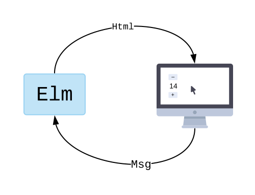

The Elm program produces HTML to show on screen, and then the computer sends back messages of what is going on. "They clicked a button!"

What happens within the Elm program though? It always breaks into three parts:

* **Model** — the state of your application
* **View** — a way to turn your state into HTML
* **Update** — a way to update your state based on messages

These three concepts are the core of **The Elm Architecture**.

The next few examples are going to show how to use this pattern for user input, like buttons and text fields. It will make this much more concrete!


### Follow Along

The examples are all available in the online editor:

[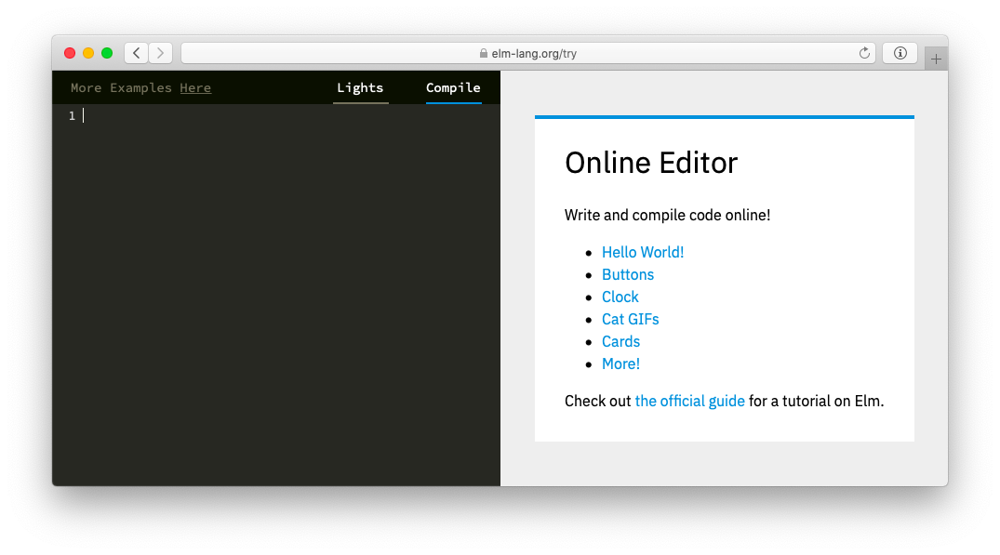](https://elm-lang.org/try)

This editor shows hints in the top left corner:

<video id="hints-video" width="360" height="180" autoplay loop style="margin: 0.55em 0 1em 2em;" onclick="var v = document.getElementById('hints-video'); v.paused ? (v.play(), v.style.opacity = 1) : (v.pause(), v.style.opacity = 0.5)">
  <source src="assets/videos/architecture/hints.mp4" type="video/mp4">
</video>

Be sure to try out the hints if you run into something confusing!


### Buttons

Our first example is a counter that can be incremented or decremented.

I included the full program below. Click the blue "Edit" button to mess with it in the online editor. Try changing text on one of the buttons. **Click the blue button now!**

[Edit](https://elm-lang.org/examples/buttons)

```elm
import Browser
import Html exposing (Html, button, div, text)
import Html.Events exposing (onClick)


-- MAIN


main =
  Browser.sandbox { init = init, update = update, view = view }


-- MODEL

type alias Model = Int

init : Model
init =
  0


-- UPDATE

type Msg = Increment | Decrement

update : Msg -> Model -> Model
update msg model =
  case msg of
    Increment ->
      model + 1

    Decrement ->
      model - 1


-- VIEW

view : Model -> Html Msg
view model =
  div []
    [ button [ onClick Decrement ] [ text "-" ]
    , div [] [ text (String.fromInt model) ]
    , button [ onClick Increment ] [ text "+" ]
    ]
```
@Elm.eval

Now that you have poked around the code a little bit, you may have some questions. What is the `main` value doing? How do the different parts fit together? Let's go through the code and talk about it.

> **Note:** The code here uses [type annotations](#reading-types), [type aliases](#type-aliases), and [custom types](#custom-types). The point of this section is to get a feeling for The Elm Architecture though, so we will not cover them until a bit later. I encourage you to peek ahead if you are getting stuck on these aspects!


### Main

The `main` value is special in Elm. It describes what gets shown on screen. In this case, we are going to initialize our application with the `init` value, the `view` function is going to show everything on screen, and user input is going to be fed into the `update` function. Think of this as the high-level description of our program.


### Model

Data modeling is extremely important in Elm. The point of the **model** is to capture all the details about your application as data.

To make a counter, we need to keep track of a number that is going up and down. That means our model is really small this time:

```elm
type alias Model = Int
```

We just need an `Int` value to track the current count. We can see that in our initial value:

```elm
init : Model
init =
  0
```

The initial value is zero, and it will go up and down as people press different buttons.


### View

We have a model, but how do we show it on screen? That is the role of the `view` function:

```elm
view : Model -> Html Msg
view model =
  div []
    [ button [ onClick Decrement ] [ text "-" ]
    , div [] [ text (String.fromInt model) ]
    , button [ onClick Increment ] [ text "+" ]
    ]
```

This function takes in the `Model` as an argument. It outputs HTML. So we are saying that we want to show a decrement button, the current count, and an increment button.

Notice that we have an `onClick` handler for each button. These are saying: **when someone clicks, generate a message**. So the plus button is generating an `Increment` message. What is that and where does it go? To the `update` function!


### Update

The `update` function describes how our `Model` will change over time.

We define two messages that it might receive:

```elm
type Msg = Increment | Decrement
```

From there, the `update` function just describes what to do when you receive one of these messages.

```elm
update : Msg -> Model -> Model
update msg model =
  case msg of
    Increment ->
      model + 1

    Decrement ->
      model - 1
```

If you get an `Increment` message, you increment the model. If you get a `Decrement` message, you decrement the model.

So whenever we get a message, we run it through `update` to get a new model. We then call `view` to figure out how to show the new model on screen. Then repeat! User input generates a message, `update` the model, `view` it on screen. Etc.


### Overview

Now that you have seen all the parts of an Elm program, it may be a bit easier to see how they fit into the diagram we saw earlier:


Elm starts by rendering the initial value on screen. From there you enter into this loop:

1. Wait for user input.
2. Send a message to `update`
3. Produce a new `Model`
4. Call `view` to get new HTML
5. Show the new HTML on screen
6. Repeat!

This is the essence of The Elm Architecture. Every example we see from now on will be a slight variation on this basic pattern.


> **Exercise:** Add a button to reset the counter to zero:
>
> 1. Add a `Reset` variant to the `Msg` type
> 2. Add a `Reset` branch in the `update` function
> 3. Add a button in the `view` function.
>
> You can edit the example in the online editor [here](https://elm-lang.org/examples/buttons).
>
> If that goes well, try adding another button to increment by steps of 10.


### Text Fields

We are about to create a simple app that reverses the contents of a text field.

Click the blue button to look at this program in the online editor. Try to check out the hint for the `type` keyword. **Click the blue button now!**

[Edit](https://elm-lang.org/examples/text-fields)

```elm
import Browser
import Html exposing (Html, Attribute, div, input, text)
import Html.Attributes exposing (..)
import Html.Events exposing (onInput)


-- MAIN


main =
  Browser.sandbox { init = init, update = update, view = view }


-- MODEL


type alias Model =
  { content : String
  }


init : Model
init =
  { content = "" }


-- UPDATE


type Msg
  = Change String


update : Msg -> Model -> Model
update msg model =
  case msg of
    Change newContent ->
      { model | content = newContent }


-- VIEW


view : Model -> Html Msg
view model =
  div []
    [ input [ placeholder "Text to reverse", value model.content, onInput Change ] []
    , div [] [ text (String.reverse model.content) ]
    ]
```
@Elm.eval

This code is a slight variant of the previous example. You set up a model. You define some messages. You say how to `update`. You make your `view`. The difference is just in how we filled this skeleton in. Let's walk through that!


### Model

I always start by guessing at what my `Model` should be. We know we have to keep track of whatever the user has typed into the text field. We need that information to know how to render the reversed text. So we go with this:

```elm
type alias Model =
  { content : String
  }
```

This time I chose to represent the model as a record. The record stores the user input in the `content` field.

> **Note:** You may be wondering, why bother having a record if it only holds one entry? Couldn't you just use the string directly? Sure! But starting with a record makes it easy to add more fields as our app gets more complicated. When the time comes where we want *two* text inputs, we will have to do much less fiddling around.


### View

We have our model, so I usually proceed by creating a `view` function:

```elm
view : Model -> Html Msg
view model =
  div []
    [ input [ placeholder "Text to reverse", value model.content, onInput Change ] []
    , div [] [ text (String.reverse model.content) ]
    ]
```

We create a `<div>` with two children. The interesting child is the `<input>` node which has three attributes:

- `placeholder` is the text that shows when there is no content
- `value` is the current content of this `<input>`
- `onInput` sends messages when the user types in this `<input>` node

Typing in "bard" this would produce four messages:

1. `Change "b"`
2. `Change "ba"`
3. `Change "bar"`
4. `Change "bard"`

These would be fed into our `update` function.


### Update

There is only one kind of message in this program, so our `update` only has to handle one case:

```elm
type Msg
  = Change String

update : Msg -> Model -> Model
update msg model =
  case msg of
    Change newContent ->
      { model | content = newContent }
```

When we receive a message that the `<input>` node has changed, we update the `content` of our model. So if you typed in "bard" the resulting messages would produce the following models:

1. `{ content = "b" }`
2. `{ content = "ba" }`
3. `{ content = "bar" }`
4. `{ content = "bard" }`

We need to track this information explicitly in our model, otherwise there is no way to show the reversed text in our `view` function!

> **Exercise:** Go to the example in the online editor [here](https://elm-lang.org/examples/text-fields) and show the length of the `content` in your `view` function. Use the [`String.length`](https://package.elm-lang.org/packages/elm/core/latest/String#length) function!
>
> **Note:** If you want more info on exactly how the `Change` values are working in this program, jump ahead to the sections on [custom types](#custom-types) and [pattern matching](#pattern-matching).


### Forms

Now we will make a rudimentary form. It has a field for your name, a field for your password, and a field to verify that password. We will also do some very simple validation to check if the passwords match.

I included the full program below. Click the blue "Edit" button to mess with it in the online editor. Try introducing a typo to see some error messages. Try misspelling a record field like `password` or a function like `placeholder`. **Click the blue button now!**

[Edit](https://elm-lang.org/examples/forms)

```elm
import Browser
import Html exposing (..)
import Html.Attributes exposing (..)
import Html.Events exposing (onInput)


-- MAIN


main =
  Browser.sandbox { init = init, update = update, view = view }


-- MODEL


type alias Model =
  { name : String
  , password : String
  , passwordAgain : String
  }


init : Model
init =
  Model "" "" ""


-- UPDATE


type Msg
  = Name String
  | Password String
  | PasswordAgain String


update : Msg -> Model -> Model
update msg model =
  case msg of
    Name name ->
      { model | name = name }

    Password password ->
      { model | password = password }

    PasswordAgain password ->
      { model | passwordAgain = password }


-- VIEW


view : Model -> Html Msg
view model =
  div []
    [ viewInput "text" "Name" model.name Name
    , viewInput "password" "Password" model.password Password
    , viewInput "password" "Re-enter Password" model.passwordAgain PasswordAgain
    , viewValidation model
    ]


viewInput : String -> String -> String -> (String -> msg) -> Html msg
viewInput t p v toMsg =
  input [ type_ t, placeholder p, value v, onInput toMsg ] []


viewValidation : Model -> Html msg
viewValidation model =
  if model.password == model.passwordAgain then
    div [ style "color" "green" ] [ text "OK" ]
  else
    div [ style "color" "red" ] [ text "Passwords do not match!" ]
```
@Elm.eval

This is pretty similar to our [text field example](#text-fields) but with more fields.


### Model

I always start out by guessing at the `Model`. We know there are going to be three text fields, so let's just go with that:

```elm
type alias Model =
  { name : String
  , password : String
  , passwordAgain : String
  }
```

I usually try to start with a minimal model, maybe with just one field. I then attempt to write the `view` and `update` functions. That often reveals that I need to add more to my `Model`. Building the model gradually like this means I can have a working program through the development process. It may not have all the features yet, but it is getting there!


### Update

Sometimes you have a pretty good idea of what the basic update code will look like. We know we need to be able to change our three fields, so we need messages for each case.

```elm
type Msg
  = Name String
  | Password String
  | PasswordAgain String
```

This means our `update` needs a case for all three variations:

```elm
update : Msg -> Model -> Model
update msg model =
  case msg of
    Name name ->
      { model | name = name }

    Password password ->
      { model | password = password }

    PasswordAgain password ->
      { model | passwordAgain = password }
```

Each case uses the record update syntax to make sure the appropriate field is transformed. This is similar to the previous example, except with more cases.

We get a little bit fancier than normal in our `view` though.


### View

This `view` function is using **helper functions** to make things a bit more organized:

```elm
view : Model -> Html Msg
view model =
  div []
    [ viewInput "text" "Name" model.name Name
    , viewInput "password" "Password" model.password Password
    , viewInput "password" "Re-enter Password" model.passwordAgain PasswordAgain
    , viewValidation model
    ]
```

In previous examples we were using `input` and `div` directly. Why did we stop?

The neat thing about HTML in Elm is that `input` and `div` are just normal functions. They take (1) a list of attributes and (2) a list of child nodes. **Since we are using normal Elm functions, we have the full power of Elm to help us build our views!** We can refactor repetitive code out into customized helper functions. That is exactly what we are doing here!

So our `view` function has three calls to `viewInput`:

```elm
viewInput : String -> String -> String -> (String -> msg) -> Html msg
viewInput t p v toMsg =
  input [ type_ t, placeholder p, value v, onInput toMsg ] []
```

This means that writing `viewInput "text" "Name" "Bill" Name` in Elm would turn into an HTML value like `<input type="text" placeholder="Name" value="Bill">` when shown on screen.

The fourth entry is more interesting. It is a call to `viewValidation`:

```elm
viewValidation : Model -> Html msg
viewValidation model =
  if model.password == model.passwordAgain then
    div [ style "color" "green" ] [ text "OK" ]
  else
    div [ style "color" "red" ] [ text "Passwords do not match!" ]
```

This function first compares the two passwords. If they match, you get green text and a positive message. If they do not match, you get red text and a helpful message.

These helper functions begin to show the benefits of having our HTML library be normal Elm code. We _could_ put all that code into our `view`, but making helper functions is totally normal in Elm, even in view code. "Is this getting hard to understand? Maybe I can break out a helper function!"

> **Exercises:** Go look at this example in the online editor [here](https://elm-lang.org/examples/forms). Try to add the following features to the `viewValidation` helper function:
>
>  - Check that the password is longer than 8 characters.
>  - Make sure the password contains upper case, lower case, and numeric characters.
>
> Use the functions from the [`String`](https://package.elm-lang.org/packages/elm/core/latest/String) module for these exercises!
>
> **Warning:** We need to learn a lot more before we start sending HTTP requests. Keep reading all the way to the section on HTTP before trying it yourself. It will be significantly easier with proper guidance!
>
> **Note:** It seems like efforts to make generic validation libraries have not been too successful. I think the problem is that the checks are usually best captured by normal Elm functions. Take some args, give back a `Bool` or `Maybe`. E.g. Why use a library to check if two strings are equal? So as far as we know, the simplest code comes from writing the logic for your particular scenario without any special extras. So definitely give that a shot before deciding you need something more complex!


## Types

One of Elm's major benefits is that **users do not see runtime errors in practice**. This is possible because the Elm compiler can analyze your source code very quickly to see how values flow through your program. If a value can ever be used in an invalid way, the compiler tells you about it with a friendly error message. This is called *type inference*. The compiler figures out what *type* of values flow in and out of all your functions.

### An Example of Type Inference

The following code defines a `toFullName` function which extracts a person’s full name as a string:

```elm
toFullName person =
  person.firstName ++ " " ++ person.lastName

fullName =
  toFullName { fistName = "Hermann", lastName = "Hesse" }
```

Like in JavaScript or Python, we just write the code with no extra clutter. Do you see the bug though?

In JavaScript, the equivalent code spits out `"undefined Hesse"`. Not even an error! Hopefully one of your users will tell you about it when they see it in the wild. In contrast, the Elm compiler just looks at the source code and tells you:

```text
-- TYPE MISMATCH ---------------------------------------------------------------

The argument to function `toFullName` is causing a mismatch.

6│   toFullName { fistName = "Hermann", lastName = "Hesse" }
                ^^^^^^^^^^^^^^^^^^^^^^^^^^^^^^^^^^^^^^^^^^^^
Function `toFullName` is expecting the argument to be:

    { …, firstName : … }

But it is:

    { …, fistName : … }

Hint: I compared the record fields and found some potential typos.

    firstName <-> fistName
```

It sees that `toFullName` is getting the wrong *type* of argument. Like the hint in the error message says, someone accidentally wrote `fist` instead of `first`.

It is great to have an assistant for simple mistakes like this, but it is even more valuable when you have hundreds of files and a bunch of collaborators making changes. No matter how big and complex things get, the Elm compiler checks that *everything* fits together properly just based on the source code.

The better you understand types, the more the compiler feels like a friendly assistant. So let's start learning more!


### Reading Types

In the [Core Language](#core-language) section of this book, we went through a bunch of interactive examples to get a feeling for the language. Well, we are going to do it again, but with a new question in mind. What **type** of value is that?


### Primitives and Lists

Let's enter some simple expressions and see what happens:

```elm
"hello"

not True

round 3.1415
```
@Elm.repl

Click on this black box ⬆️ and the cursor should start blinking. Type in `3.1415` and press the ENTER key. It should print out `3.1415` followed by the type `Float`.

Okay, but what is going on here exactly? Each entry shows value along with what **type** of value it happens to be. You can read these examples out loud like this:

- The value `"hello"` is a `String`.
- The value `False` is a `Bool`.
- The value `3` is an `Int`.
- The value `3.1415` is a `Float`.

Elm is able to figure out the type of any value you enter! Let's see what happens with lists:

```elm
[ "Alice", "Bob" ]

[ 1.0, 8.6, 42.1 ]
```
@Elm.repl

You can read these types as:

1. We have a `List` filled with `String` values.
2. We have a `List` filled with `Float` values.

The **type** is a rough description of the particular value we are looking at.


### Functions

Let's see the type of some functions:

```elm
String.length
```
@Elm.repl

Try entering `round` or `sqrt` to see some other function types ⬆️

The `String.length` function has type `String -> Int`. This means it *must* take in a `String` argument, and it will definitely return an `Int` value. So let's try giving it an argument:

```elm
String.length "Supercalifragilisticexpialidocious"
```
@Elm.repl

So we start with a `String -> Int` function and give it a `String` argument. This results in an `Int`.

What happens when you do not give a `String` though? Try entering `String.length [1,2,3]` or `String.length True` to see what happens ⬆️

You will find that a `String -> Int` function *must* get a `String` argument!

> **Note:** Functions that take multiple arguments end up having more and more arrows. For example, here is a function that takes two arguments:
>
> ```elm
> String.repeat
> ```
> @Elm.repl
>
> Giving two arguments like `String.repeat 3 "ha"` will produce `"hahaha"`. It works to think of `->` as a weird way to separate arguments, but I explain the real reasoning [here](#function-types). It is pretty neat!


### Type Annotations

So far we have just let Elm figure out the types, but it also lets you write a **type annotation** on the line above a definition. So when you are writing code, you can say things like this:

```elm
half : Float -> Float
half n =
  n / 2

-- half 256 == 128
-- half "3" -- error!

hypotenuse : Float -> Float -> Float
hypotenuse a b =
  sqrt (a^2 + b^2)

-- hypotenuse 3 4  == 5
-- hypotenuse 5 12 == 13

checkPower : Int -> String
checkPower powerLevel =
  if powerLevel > 9000 then "It's over 9000!!!" else "Meh"

-- checkPower 9001 == "It's over 9000!!!"
-- checkPower True -- error!
```

Adding type annotations is not required, but it is definitely recommended! Benefits include:

1. **Error Message Quality** — When you add a type annotation, it tells the compiler what you are _trying_ to do. Your implementation may have mistakes, and now the compiler can compare against your stated intent. “You said argument `powerLevel` was an `Int`, but it is getting used as a `String`!”
2. **Documentation** — When you revisit code later (or when a colleague visits it for the first time) it can be really helpful to see exactly what is going in and out of the function without having to read the implementation super carefully.

People can make mistakes in type annotations though, so what happens if the annotation does not match the implementation? The compiler figures out all the types on its own, and it checks that your annotation matches the real answer. In other words, the compiler will always verify that all the annotations you add are correct. So you get better error messages _and_ documentation always stays up to date!


### Type Variables

As you look through more Elm code, you will start to see type annotations with lower-case letters in them. A common example is the `List.length` function:

```elm
List.length
```
@Elm.repl

Notice that lower-case `a` in the type? That is called a **type variable**. It can vary depending on how [`List.length`](https://package.elm-lang.org/packages/elm/core/latest/List#length) is used:

```elm
List.length [1,1,2,3,5,8]

List.length [ "a", "b", "c" ]

List.length [ True, False ]
```
@Elm.repl

We just want the length, so it does not matter what is in the list. So the type variable `a` is saying that we can match any type. Let’s look at another common example:

```elm
List.reverse

List.reverse [ "a", "b", "c" ]

List.reverse [ True, False ]
```
@Elm.repl

Again, the type variable `a` can vary depending on how [`List.reverse`](https://package.elm-lang.org/packages/elm/core/latest/List#reverse) is used. But in this case, we have an `a` in the argument and in the result. This means that if you give a `List Int` you must get a `List Int` as well. Once we decide what `a` is, that’s what it is everywhere.

> **Note:** Type variables must start with a lower-case letter, but they can be full words. We could write the type of `List.length` as `List value -> Int` and we could write the type of `List.reverse` as `List element -> List element`. It is fine as long as they start with a lower-case letter. Type variables `a` and `b` are used by convention in many places, but some type annotations benefit from more specific names.

### Constrained Type Variables

There is a special variant of type variables in Elm called **constrained** type variables. The most common example is the `number` type. The [`negate`](https://package.elm-lang.org/packages/elm/core/latest/Basics#negate) function uses it:

```elm
negate
```
@Elm.repl

Try expressions like `negate 3.1415` and `negate (round 3.1415)` and `negate "hi"` ⬆️

Normally type variables can get filled in with anything, but `number` can only be filled in by `Int` and `Float` values. It _constrains_ the possibilities.

The full list of constrained type variables is:

- `number` permits `Int` and `Float`
- `appendable` permits `String` and `List a`
- `comparable` permits `Int`, `Float`, `Char`, `String`, and lists/tuples of `comparable` values
- `compappend` permits `String` and `List comparable`

These constrained type variables exist to make operators like `(+)` and `(<)` a bit more flexible.

By now we have covered types for values and functions pretty well, but what does this look like when we start wanting more complex data structures?


### Type Aliases

Type annotations can start to get long. This might be a real problem if you have records with many fields! This is the core motivation for type aliases. A **type alias** is a shorter name for a type. For example, you could create a `User` alias like this:

```elm
type alias User =
  { name : String
  , age : Int
  }
```

Rather than writing the whole record type all the time, we can just say `User` instead. This helps us write type annotations that are easier to read:

```elm
-- WITH ALIAS

isOldEnoughToVote : User -> Bool
isOldEnoughToVote user =
  user.age >= 18


-- WITHOUT ALIAS

isOldEnoughToVote : { name : String, age : Int } -> Bool
isOldEnoughToVote user =
  user.age >= 18
```

These two definitions are equivalent, but the one with a type alias is shorter and easier to read. So all we are doing is making an **alias** for a long type.


### Models

It is extremely common to use type aliases when designing a model. When we were learning about The Elm Architecture, we saw a model like this:

```elm
type alias Model =
  { name : String
  , password : String
  , passwordAgain : String
  }
```

The main benefit of using a type alias for this is when we write the type annotations for the `update` and `view` functions. Writing `Msg -> Model -> Model` is so much nicer than the fully expanded version! It has the added benefit that we can add fields to our model without needing to change any type annotations.


### Record Constructors

When you create a type alias specifically for a record, it also generates a **record constructor**. So if we define a `User` type alias, we can start building records like this:

```elm
type alias User = { name : String, age : Int }

User

User "Sue" 58

User "Tom" 31
```
@Elm.repl

Try creating another user or creating a type alias of your own ⬆️

Note that the order of arguments in the record constructor match the order of fields in the type alias!

And again, **this is only for records.** Making type aliases for other types will not result in a constructor.


> **Note:** Custom types used to be referred to as “union types” in Elm. Names from other communities include [tagged unions](https://en.wikipedia.org/wiki/Tagged_union) and [ADTs](https://en.wikipedia.org/wiki/Algebraic_data_type).

### Custom Types

So far we have seen a bunch of types like `Bool`, `Int`, and `String`. But how do we define our own?

Say we are making a chat room. Everyone needs a name, but maybe some users do not have a permanent account. They just give a name each time they show up.

We can describe this situation by defining a `UserStatus` type, listing all the possible variations:

```elm
type UserStatus = Regular | Visitor
```

The `UserStatus` type has two **variants**. Someone can be a `Regular` or a `Visitor`. So we could represent a user as a record like this:

```elm
type UserStatus
  = Regular
  | Visitor

type alias User =
  { status : UserStatus
  , name : String
  }

thomas = { status = Regular, name = "Thomas" }
kate95 = { status = Visitor, name = "kate95" }
```

So now we can track if someone is a `Regular` with an account or a `Visitor` who is just passing through. It is not too tough, but we can make it simpler!

Rather than creating a custom type and a type alias, we can represent all this with just a single custom type. The `Regular` and `Visitor` variants each have an associated data. In our case, the associated data is a `String` value:

```elm
type User
  = Regular String
  | Visitor String

thomas = Regular "Thomas"
kate95 = Visitor "kate95"
```

The data is attached directly to the variant, so there is no need for the record anymore.

Another benefit of this approach is that each variant can have different associated data. Say that `Regular` users gave their age when they signed up. There is no nice way to capture that with records, but when you define your own custom type it is no problem. Let's add some associated data to the `Regular` variant in an interactive example:

```elm
type User
  = Regular String Int
  | Visitor String

Regular

Visitor

Regular "Thomas" 44

Visitor "kate95"
```
@Elm.repl

Try defining a `Regular` visitor with a name and age ⬆️

We only added an age, but variants of a type can diverge quite dramatically. For example, maybe we want to add location for `Regular` users so we can suggest regional chat rooms. Add more associated data! Or maybe we want to have anonymous users. Add a third variant called `Anonymous`. Maybe we end up with:

```elm
type User
  = Regular String Int Location
  | Visitor String
  | Anonymous
```

No problem! Let’s see some other examples now.


### Messages

In the architecture section, we saw a couple of examples of defining a `Msg` type. This sort of type is extremely common in Elm. In our chat room, we might define a `Msg` type like this:

```elm
type Msg
  = PressedEnter
  | ChangedDraft String
  | ReceivedMessage { user : User, message : String }
  | ClickedExit
```

We have four variants. Some variants have no associated data, others have a bunch. Notice that `ReceivedMessage` actually has a record as associated data. That is totally fine. Any type can be associated data! This allows you to describe interactions in your application very precisely.


### Modeling

Custom types become extremely powerful when you start modeling situations very precisely. For example, if you are waiting for some data to load, you might want to model it with a custom type like this:

```elm
type Profile
  = Failure
  | Loading
  | Success { name : String, description : String }
```

So you can start in the `Loading` state and then transition to `Failure` or `Success` depending on what happens. This makes it really simple to write a `view` function that always shows something reasonable when data is loading.

Now we know how to create custom types, the next section will show how to use them!


> **Note: Custom types are the most important feature in Elm.** They have a lot of depth, especially once you get in the habit of trying to model scenarios more precisely. I tried to share some of this depth in [Types as Sets](#types-as-sets) and [Types as Bits](#types-as-bits) in the appendix. I hope you find them helpful!


### Pattern Matching

On the previous page, we learned how to create [custom types](#custom-types) with the `type` keyword. Our primary example was a `User` in a chat room:

```elm
type User
  = Regular String Int
  | Visitor String
```

Regulars have a name and age, whereas visitors only have a name. So we have our custom type, but how do we actually use it?


### `case`

Say we want a `toName` function that decides on a name to show for each `User`. We need to use a `case` expression:

```elm
toName : User -> String
toName user =
  case user of
    Regular name age ->
      name

    Visitor name ->
      name

-- toName (Regular "Thomas" 44) == "Thomas"
-- toName (Visitor "kate95")    == "kate95"
```

The `case` expression allows us to branch based on which variant we happen to see, so whether we see Thomas or Kate, we always know how to show their name.

And if we try invalid arguments like `toName (Visitar "kate95")` or `toName Anonymous`, the compiler tells us about it immediately. This means many simple mistakes can be fixed in seconds, rather than making it to users and costing a lot more time overall.


### Wild Cards

The `toName` function we just defined works great, but notice that the `age` is not used in the implementation? When some of the associated data is unused, it is common to use a “wild card” instead of giving it a name:

```elm
toName : User -> String
toName user =
  case user of
    Regular name _ ->
      name

    Visitor name ->
      name
```

The `_` acknowledges the data there, but also saying explicitly that nobody is using it.


## Error Handling

One of the guarantees of Elm is that you will not see runtime errors in practice. This is partly because **Elm treats errors as data**. Rather than crashing, we model the possibility of failure explicitly with custom types. For example, say you want to turn user input into an age. You might create a custom type like this:

```elm
type MaybeAge
  = Age Int
  | InvalidInput

toAge : String -> MaybeAge
toAge userInput =
  ...

-- toAge "24" == Age 24
-- toAge "99" == Age 99
-- toAge "ZZ" == InvalidInput
```

No matter what input is given to the `toAge` function, it always produces a value. Valid input produces values like `Age 24` and `Age 99`, whereas invalid input produces the `InvalidInput` value. From there, we use pattern matching which will ensure that both possibilities are accounted for. No crashing!

This kind of thing comes up all the time! For example, maybe you want to turn a bunch of user input into a `Post` to share with others. But what happens if they forget to add a title? Or there is no content in the post? We could model all these problems explicitly:

```elm
type MaybePost
  = Post { title : String, content : String }
  | NoTitle
  | NoContent

toPost : String -> String -> MaybePost
toPost title content =
  ...

-- toPost "hi" "sup?" == Post { title = "hi", content = "sup?" }
-- toPost ""   ""     == NoTitle
-- toPost "hi" ""     == NoContent
```

Instead of just saying that the input is invalid, we are describing each of the ways things might have gone wrong. If we have a `viewPreview : MaybePost -> Html msg` function to preview valid posts, now we can give more specific error messages in the preview area when something goes wrong!

These kinds of situations are extremely common. It is often valuable to create a custom type for your exact situation, but in some of the simpler cases, you can use an off-the-shelf type instead. So the rest of this chapter explores the `Maybe` and `Result` types, showing how they can help you treat errors as data!


### Maybe

As you work more with Elm, you will start seeing the [`Maybe`](https://package.elm-lang.org/packages/elm-lang/core/latest/Maybe#Maybe) type quite frequently. It is defined like this:

```elm
type Maybe a
  = Just a
  | Nothing

-- Just 3.14 : Maybe Float
-- Just "hi" : Maybe String
-- Just True : Maybe Bool
-- Nothing   : Maybe a
```

This is a type with two variants. You either have `Nothing` or you have `Just` a value. The type variable makes it possible to have a `Maybe Float` and `Maybe String` depending on the particular value.

This can be handy in two main scenarios: partial functions and optional fields.

### Partial Functions

Sometimes you want a function that gives an answer for some inputs, but not others. Many people run into this with [`String.toFloat`](https://package.elm-lang.org/packages/elm-lang/core/latest/String#toFloat) when trying to convert user input into numbers. Let's see it in action:

```elm
String.toFloat

String.toFloat "3.1415"

String.toFloat "abc"
```
@Elm.repl

Try calling `String.toFloat` with other strings to see what happens ⬆️

Not all strings make sense as numbers, so this function models that explicitly. Can a string be turned into a float? Maybe! From there we can pattern match on the resulting data and continue as appropriate.

> **Exercise:** I wrote a little program [here](https://ellie-app.com/bJSMQz9tydqa1) that converts from Celsius to Fahrenheit. Try refactoring the `view` code in different ways. Can you put a red border around invalid input? Can you add more conversions? Fahrenheit to Celsius? Inches to Meters?

### Optional Fields

Another place you commonly see `Maybe` values is in records with optional fields.

For example, say we are running a social networking website. Connecting people, friendship, etc. You know the spiel. The Onion outlined our real goals best back in 2011: [mine as much data as possible for the CIA](https://www.theonion.com/cias-facebook-program-dramatically-cut-agencys-costs-1819594988). And if we want *all* the data, we need to ease people into it. Let them add it later. Add features that encourage them to share more and more information over time.

So let's start with a simple model of a user. They must have a name, but we are going to make the age optional.

```elm
type alias User =
  { name : String
  , age : Maybe Int
  }
```

Now say Sue creates an account, but decides not to provide her birthday:

```elm
sue : User
sue =
  { name = "Sue", age = Nothing }
```

Sue’s friends cannot wish her a happy birthday though. I wonder if they _really_ care about her... Later Tom creates a profile and *does* give his age:

```elm
tom : User
tom =
  { name = "Tom", age = Just 24 }
```

Great, that will be nice on his birthday. But more importantly, Tom is part of a valuable demographic! The advertisers will be pleased.

Alright, so now that we have some users, how can we market alcohol to them without breaking any laws? People would probably be mad if we market to people under 21, so let's check for that:

```elm
canBuyAlcohol : User -> Bool
canBuyAlcohol user =
  case user.age of
    Nothing ->
      False

    Just age ->
      age >= 21
```

Notice that the `Maybe` type forces us to pattern match on the user's age. It is actually impossible to write code where you forget that users may not have an age. Elm makes sure of it! Now we can advertise alcohol confident that we are not influencing minors directly! Only their older peers.


### Avoiding Overuse

This `Maybe` type is quite useful, but there are limits. Beginners are particularly prone to getting excited about `Maybe` and using it everywhere, even though a custom type would be more appropriate.

For example, say we have an exercise app where we compete against our friends. You start with a list of your friend’s names, but you can load more fitness information about them later. You might be tempted to model it like this:

```elm
type alias Friend =
  { name : String
  , age : Maybe Int
  , height : Maybe Float
  , weight : Maybe Float
  }
```

All the information is there, but you are not really modeling the way your particular application works. It would be much more precise to model it like this instead:

```elm
type Friend
  = Less String
  | More String Info

type alias Info =
  { age : Int
  , height : Float
  , weight : Float
  }
```

This new model is capturing much more about your application. There are only two real situations. Either you have just the name, or you have the name and a bunch of information. In your view code, you just think about whether you are showing a `Less` or `More` view of the friend. You do not have to answer questions like “what if I have an `age` but not a `weight`?” That is not possible with our more precise type!

Point is, if you find yourself using `Maybe` everywhere, it is worth examining your `type` and `type alias` definitions to see if you can find a more precise representation. This often leads to a lot of nice refactors in your update and view code!


> ## Aside: Connection to `null` references
>
> The inventor of `null` references, Tony Hoare, described them like this:
>
> > I call it my billion-dollar mistake. It was the invention of the null reference in 1965. At that time, I was designing the first comprehensive type system for references in an object oriented language (ALGOL W). My goal was to ensure that all use of references should be absolutely safe, with checking performed automatically by the compiler. But I couldn't resist the temptation to put in a null reference, simply because it was so easy to implement. This has led to innumerable errors, vulnerabilities, and system crashes, which have probably caused a billion dollars of pain and damage in the last forty years.
>
> That design makes failure **implicit**. Any time you think you have a `String` you just might have a `null` instead. Should you check? Did the person giving you the value check? Maybe it will be fine? Maybe it will crash your server? I guess we will find out later!
>
> Elm avoids these problems by not having `null` references at all. We instead use custom types like `Maybe` to make failure **explicit**. This way there are never any surprises. A `String` is always a `String`, and when you see a `Maybe String`, the compiler will ensure that both variants are accounted for. This way you get the same flexibility, but without the surprise crashes.


### Result

The `Maybe` type can help with simple functions that may fail, but it does not tell you _why_ it failed. Imagine if a compiler just said `Nothing` if anything was wrong with your program. Good luck figuring out what went wrong!

This is where the [`Result`](https://package.elm-lang.org/packages/elm-lang/core/latest/Result#Result) type becomes helpful. It is defined like this:

```elm
type Result error value
  = Ok value
  | Err error
```

The point of this type is to give additional information when things go wrong. It is really helpful for error reporting and error recovery!

### Error Reporting

Perhaps we have a website where people input their age. We could check that the age is reasonable with a function like this:

```elm
isReasonableAge : String -> Result String Int
isReasonableAge input =
  case String.toInt input of
    Nothing ->
      Err "That is not a number!"

    Just age ->
      if age < 0 then
        Err "Please try again after you are born."

      else if age > 135 then
        Err "Are you some kind of turtle?"

      else
        Ok age

-- isReasonableAge "abc" == Err ...
-- isReasonableAge "-13" == Err ...
-- isReasonableAge "24"  == Ok 24
-- isReasonableAge "150" == Err ...
```

Not only can we check the age, but we can also show people error messages depending on the particulars of their input. This kind of feedback is much better than `Nothing`!


### Error Recovery

The `Result` type can also help you recover from errors. One place you see this is when making HTTP requests. Say we want to show the full text of _Anna Karenina_ by Leo Tolstoy. Our HTTP request results in a `Result Error String` to capture the fact that the request may succeed with the full text, or it may fail in a bunch of different ways:

```elm
type Error
  = BadUrl String
  | Timeout
  | NetworkError
  | BadStatus Int
  | BadBody String

-- Ok "All happy ..." : Result Error String
-- Err Timeout        : Result Error String
-- Err NetworkError   : Result Error String
```

From there we can show nicer error messages as we discussed before, but we can also try to recover from the failure! If we see a `Timeout` it may work to wait a little while and try again. Whereas if we see a `BadStatus 404` then there is no point in trying again.

The next chapter shows how to actually make HTTP requests, so we will run into the `Result` and `Error` types again very soon!


## Commands and Subscriptions

Earlier in this book we saw The Elm Architecture handle mouse and keyboard interactions, but what about talking to servers? Generating random numbers?

To answer these questions, it helps to learn more about how The Elm Architecture works behind the scenes. This will explain why things work a bit differently than in languages like JavaScript, Python, etc.


### `sandbox`

I have not made a big deal about it, but so far all of our programs were created with [`Browser.sandbox`](https://package.elm-lang.org/packages/elm/browser/latest/Browser#sandbox). We gave an initial `Model` and describe how to `update` and `view` it.

You can think of `Browser.sandbox` as setting up a system like this:

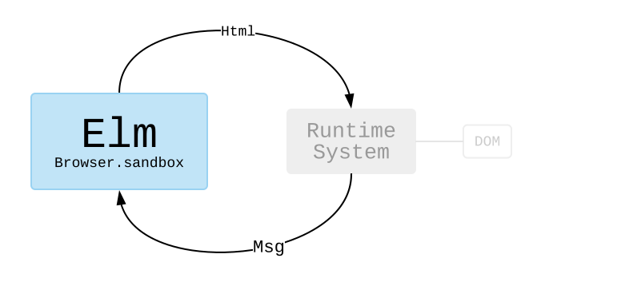

We get to stay in the world of Elm, writing functions and transforming data. This hooks up to Elm’s **runtime system**. The runtime system figures out how to render `Html` efficiently. Did anything change? What is the minimal DOM modification needed? It also figures out when someone clicks a button or types into a text field. It turns that into a `Msg` and feeds it into your Elm code.

By cleanly separating out all the DOM manipulation, it becomes possible to use extremely aggressive optimizations. So Elm’s runtime system is a big part of why Elm is [one of the fastest options available](https://elm-lang.org/blog/blazing-fast-html-round-two).

### `element`

In the next few examples, we are going to use [`Browser.element`](https://package.elm-lang.org/packages/elm/browser/latest/Browser#element) to create programs. This will introduce the ideas of **commands** and **subscriptions** which allow us to interact with the outside world.

You can think of `Browser.element` as setting up a system like this:

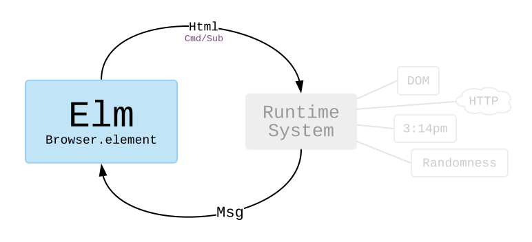

In addition to producing `Html` values, our programs will also send `Cmd` and `Sub` values to the runtime system. In this world, our programs can **command** the runtime system to make an HTTP request or to generate a random number. They can also **subscribe** to the current time.

I think commands and subscriptions make more sense when you start seeing examples, so let’s do that!

> **Note 1:** Some readers may be worrying about asset size. “A runtime system? That sounds big!” It is not! In fact, Elm assets are [exceptionally small](https://elm-lang.org/blog/small-assets-without-the-headache) when compared to popular alternatives.
>
> **Note 2:** We are going to use packages from [`package.elm-lang.org`](https://package.elm-lang.org) in the upcoming examples. We have already been working with a couple:
>
> - [`elm/core`](https://package.elm-lang.org/packages/elm/core/latest/)
> - [`elm/html`](https://package.elm-lang.org/packages/elm/html/latest/)
>
> But now we will start getting into some fancier ones:
>
> - [`elm/http`](https://package.elm-lang.org/packages/elm/http/latest/)
> - [`elm/json`](https://package.elm-lang.org/packages/elm/json/latest/)
> - [`elm/random`](https://package.elm-lang.org/packages/elm/random/latest/)
> - [`elm/time`](https://package.elm-lang.org/packages/elm/time/latest/)
>
> There are tons of other packages on `package.elm-lang.org` though! So when you are making your own Elm programs locally, it will probably involve running some commands like this in the terminal:
>
>```bash
> elm init
> elm install elm/http
> elm install elm/random
> ```
>
> That would set up an `elm.json` file with `elm/http` and `elm/random` as dependencies.
>
> I will be mentioning the packages we are using in the following examples, so I hope this gives some context on what that is all about!


### HTTP

It is often helpful to grab information from elsewhere on the internet.

For example, say we want to load the full text of _Public Opinion_ by Walter Lippmann. Published in 1922, this book provides a historical perspective on the rise of mass media and its implications for democracy. For our purposes here, we will focus on how to use the [`elm/http`](https://package.elm-lang.org/packages/elm/http/latest) package to get this book into our program!

Click the blue "Edit" button to look through this program in the online editor. You will probably see the screen say "Loading..." before the full book shows up. **Click the blue button now!**

[Edit](https://elm-lang.org/examples/book)

```elm
import Browser
import Html exposing (Html, text, pre)
import Http


-- MAIN


main =
  Browser.element
    { init = init
    , update = update
    , subscriptions = subscriptions
    , view = view
    }


-- MODEL


type Model
  = Failure
  | Loading
  | Success String


init : () -> (Model, Cmd Msg)
init _ =
  ( Loading
  , Http.get
      { url = "https://elm-lang.org/assets/public-opinion.txt"
      , expect = Http.expectString GotText
      }
  )


-- UPDATE


type Msg
  = GotText (Result Http.Error String)


update : Msg -> Model -> (Model, Cmd Msg)
update msg model =
  case msg of
    GotText result ->
      case result of
        Ok fullText ->
          (Success fullText, Cmd.none)

        Err _ ->
          (Failure, Cmd.none)


-- SUBSCRIPTIONS


subscriptions : Model -> Sub Msg
subscriptions model =
  Sub.none


-- VIEW


view : Model -> Html Msg
view model =
  case model of
    Failure ->
      text "I was unable to load your book."

    Loading ->
      text "Loading..."

    Success fullText ->
      pre [] [ text fullText ]
```
@Elm.eval

Some parts of this should be familiar from previous examples of The Elm Architecture. We still have a `Model` of our application. We still have an `update` that reacts to messages. We still have a `view` function that shows everything on screen.

The new parts extend the core pattern we saw before with some changes in `init` and `update`, and the addition of `subscription`.


### `init`

The `init` function describes how to initialize our program:

```elm
init : () -> (Model, Cmd Msg)
init _ =
  ( Loading
  , Http.get
      { url = "https://elm-lang.org/assets/public-opinion.txt"
      , expect = Http.expectString GotText
      }
  )
```

Like always, we have to produce the initial `Model`, but now we are also producing some **command** of what we want to do immediately. That command will eventually produce a `Msg` that gets fed into the `update` function.

Our book website starts in the `Loading` state, and we want to GET the full text of our book. When making a GET request with [`Http.get`](https://package.elm-lang.org/packages/elm/http/latest/Http#get), we specify the `url` of the data we want to fetch, and we specify what we `expect` that data to be. So in our case, the `url` is pointing at some data on the Elm website, and we `expect` it to be a big `String` we can show on screen.

The `Http.expectString GotText` line is saying a bit more than that we `expect` a `String` though. It is also saying that when we get a response, it should be turned into a `GotText` message:

```elm
type Msg
  = GotText (Result Http.Error String)

-- GotText (Ok "The Project Gutenberg EBook of ...")
-- GotText (Err Http.NetworkError)
-- GotText (Err (Http.BadStatus 404))
```

Notice that we are using the `Result` type from a couple sections back. This allows us to fully account for the possible failures in our `update` function. Speaking of `update` functions...

> **Note:** If you are wondering why `init` is a function (and why we are ignoring the argument) we will talk about it in the upcoming chapter on JavaScript interop! (Preview: the argument lets us get information from JS on initialization.)


### `update`

Our `update` function is returning a bit more information as well:

```elm
update : Msg -> Model -> (Model, Cmd Msg)
update msg model =
  case msg of
    GotText result ->
      case result of
        Ok fullText ->
          (Success fullText, Cmd.none)

        Err _ ->
          (Failure, Cmd.none)
```

Looking at the type signature, we see that we are not just returning an updated model. We are _also_ producing a **command** of what we want Elm to do.

Moving on to the implementation, we pattern match on messages like normal. When a `GotText` message comes in, we inspect the `Result` of our HTTP request and update our model depending on whether it was a success or failure. The new part is that we also provide a command.

So in the case that we got the full text successfully, we say `Cmd.none` to indicate that there is no more work to do. We already got the full text!

And in the case that there was some error, we also say `Cmd.none` and just give up. The text of the book did not load. If we wanted to get fancier, we could pattern match on the [`Http.Error`](https://package.elm-lang.org/packages/elm/http/latest/Http#Error) and retry the request if we got a timeout or something.

The point here is that however we decide to update our model, we are also free to issue new commands. I need more data! I want a random number! Etc.

### `subscription`

The other new thing in this program is the `subscription` function. It lets you look at the `Model` and decide if you want to subscribe to certain information. In our example, we say `Sub.none` to indicate that we do not need to subscribe to anything, but we will soon see an example of a clock where we want to subscribe to the current time!


### Summary

When we create a program with `Browser.element`, we set up a system like this:


We get the ability to issue **commands** from `init` and `update`. This allows us to do things like make HTTP requests whenever we want. We also get the ability to **subscribe** to interesting information. (We will see an example of subscriptions later!)


### JSON

We just saw an example that uses HTTP to get the content of a book. That is great, but a ton of servers return data in a special format called JavaScript Object Notation, or JSON for short.

So our next example shows how to fetch some JSON data, allowing us to press a button to show random quotes from a haphazard selection of books. Click the blue "Edit" button and look through the program a bit. Maybe you have read some of these books too? **Click the blue button now!**

[Edit](https://elm-lang.org/examples/quotes)

```elm
import Browser
import Html exposing (..)
import Html.Attributes exposing (style)
import Html.Events exposing (..)
import Http
import Json.Decode exposing (Decoder, map4, field, int, string)


-- MAIN


main =
  Browser.element
    { init = init
    , update = update
    , subscriptions = subscriptions
    , view = view
    }


-- MODEL


type Model
  = Failure
  | Loading
  | Success Quote


type alias Quote =
  { quote : String
  , source : String
  , author : String
  , year : Int
  }


init : () -> (Model, Cmd Msg)
init _ =
  (Loading, getRandomQuote)


-- UPDATE


type Msg
  = MorePlease
  | GotQuote (Result Http.Error Quote)


update : Msg -> Model -> (Model, Cmd Msg)
update msg model =
  case msg of
    MorePlease ->
      (Loading, getRandomQuote)

    GotQuote result ->
      case result of
        Ok quote ->
          (Success quote, Cmd.none)

        Err _ ->
          (Failure, Cmd.none)


-- SUBSCRIPTIONS


subscriptions : Model -> Sub Msg
subscriptions model =
  Sub.none


-- VIEW


view : Model -> Html Msg
view model =
  div []
    [ h2 [] [ text "Random Quotes" ]
    , viewQuote model
    ]


viewQuote : Model -> Html Msg
viewQuote model =
  case model of
    Failure ->
      div []
        [ text "I could not load a random quote for some reason. "
        , button [ onClick MorePlease ] [ text "Try Again!" ]
        ]

    Loading ->
      text "Loading..."

    Success quote ->
      div []
        [ button [ onClick MorePlease, style "display" "block" ] [ text "More Please!" ]
        , blockquote [] [ text quote.quote ]
        , p [ style "text-align" "right" ]
            [ text "— "
            , cite [] [ text quote.source ]
            , text (" by " ++ quote.author ++ " (" ++ String.fromInt quote.year ++ ")")
            ]
        ]


-- HTTP


getRandomQuote : Cmd Msg
getRandomQuote =
  Http.get
    { url = "https://elm-lang.org/api/random-quotes"
    , expect = Http.expectJson GotQuote quoteDecoder
    }


quoteDecoder : Decoder Quote
quoteDecoder =
  map4 Quote
    (field "quote" string)
    (field "source" string)
    (field "author" string)
    (field "year" int)
```
@Elm.eval

This example is pretty similar to the last one:

- `init` starts us off in the `Loading` state, with a command to get a random quote.
- `update` handles the `GotQuote` message for whenever a new quote is available. Whatever happens there, we do not have any additional commands. It also handles the `MorePlease` message when someone presses the button, issuing a command to get more random quotes.
- `view` shows you the quotes!

The main difference is in the `getRandomCatGif` definition. Instead of using `Http.expectString`, we have switched to `Http.expectJson`. What is the deal with that?


### JSON

When you ask [`/api/random-quotes`](https://elm-lang.org/api/random-quotes) for a random quote, the server produces a string of JSON like this:

```json
{
  "quote": "December used to be a month but it is now a year",
  "source": "Letters from a Stoic",
  "author": "Seneca",
  "year": 54
}
```

We have no guarantees about any of the information here. The server can change the names of fields, and the fields may have different types in different situations. It is a wild world!

In JavaScript, the approach is to just turn JSON into JavaScript objects and hope nothing goes wrong. But if there is some typo or unexpected data, you get a runtime exception somewhere in your code. Was the code wrong? Was the data wrong? It is time to start digging around to find out!

In Elm, we validate the JSON before it comes into our program. So if the data has an unexpected structure, we learn about it immediately. There is no way for bad data to sneak through and cause a runtime exception three files over. This is accomplished with JSON decoders.


### JSON Decoders

Say we have some JSON:

```json
{
	"name": "Tom",
	"age": 42
}
```

We need to run it through a `Decoder` to access specific information. So if we wanted to get the `"age"`, we would run the JSON through a `Decoder Int` that describes exactly how to access that information:

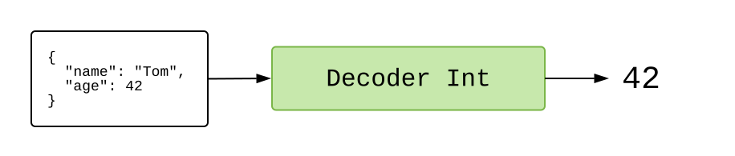

If all goes well, we get an `Int` on the other side! And if we wanted the `"name"` we would run the JSON through a `Decoder String` that describes exactly how to access it:

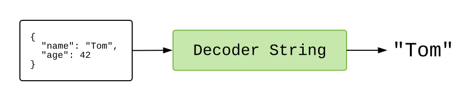

If all goes well, we get a `String` on the other side!

How do we create decoders like this though?


### Building Blocks

The [`elm/json`](https://package.elm-lang.org/packages/elm/json/latest/) package gives us the [`Json.Decode`](https://package.elm-lang.org/packages/elm/json/latest/Json-Decode) module. It is filled with tiny decoders that we can snap together.

So to get `"age"` from `{ "name": "Tom", "age": 42 }` we would create a decoder like this:

```elm
import Json.Decode exposing (Decoder, field, int)

ageDecoder : Decoder Int
ageDecoder =
  field "age" int

 -- int : Decoder Int
 -- field : String -> Decoder a -> Decoder a
```

The [`field`](https://package.elm-lang.org/packages/elm/json/latest/Json-Decode#field) function takes two arguments:

1. `String` — a field name. So we are demanding an object with an `"age"` field.
2. `Decoder a` — a decoder to try next. So if the `"age"` field exists, we will try this decoder on the value there.

So putting it together, `field "age" int` is asking for an `"age"` field, and if it exists, it runs the `Decoder Int` to try to extract an integer.

We do pretty much exactly the same thing to extract the `"name"` field:

```elm
import Json.Decode exposing (Decoder, field, string)

nameDecoder : Decoder String
nameDecoder =
  field "name" string

-- string : Decoder String
```

In this case we demand an object with a `"name"` field, and if it exists, we want the value there to be a `String`.

### Combining Decoders

But what if we want to decode _two_ fields? We snap decoders together with [`map2`](https://package.elm-lang.org/packages/elm/json/latest/Json-Decode#map2):

```elm
map2 : (a -> b -> value) -> Decoder a -> Decoder b -> Decoder value
```

This function takes in two decoders. It tries them both and combines their results. So now we can put together two different decoders:

```elm
import Json.Decode exposing (Decoder, map2, field, string, int)

type alias Person =
  { name : String
  , age : Int
  }

personDecoder : Decoder Person
personDecoder =
  map2 Person
  	(field "name" string)
  	(field "age" int)
```

So if we used `personDecoder` on `{ "name": "Tom", "age": 42 }` we would get out an Elm value like `Person "Tom" 42`.

If we really wanted to get into the spirit of decoders, we would define `personDecoder` as `map2 Person nameDecoder ageDecoder` using our previous definitions. You always want to be building your decoders up from smaller building blocks!


### Nesting Decoders

A lot of JSON data is not so nice and flat. Imagine if `/api/random-quotes/v2` was released with richer information about authors:

```json
{
  "quote": "December used to be a month but it is now a year",
  "source": "Letters from a Stoic",
  "author":
  {
    "name": "Seneca",
    "age": 68,
    "origin": "Cordoba"
  },
  "year": 54
}
```

We could handle this new scenario by nesting our nice little decoders:

```elm
import Json.Decode exposing (Decoder, map2, map4, field, int, string)

type alias Quote =
  { quote : String
  , source : String
  , author : Person
  , year : Int
  }

quoteDecoder : Decoder Quote
quoteDecoder =
  map4 Quote
    (field "quote" string)
    (field "source" string)
    (field "author" personDecoder)
    (field "year" int)

type alias Person =
  { name : String
  , age : Int
  }

personDecoder : Decoder Person
personDecoder =
  map2 Person
    (field "name" string)
    (field "age" int)
```

Notice that we do not bother decoding the `"origin"` field of the author. Decoders are fine with skipping over fields, which can be helpful when extracting a small amount of information from very large JSON values.


### Next Steps

There are a bunch of important functions in `Json.Decode` that we did not cover here:

- [`bool`](https://package.elm-lang.org/packages/elm/json/latest/Json-Decode#bool) : `Decoder Bool`
- [`list`](https://package.elm-lang.org/packages/elm/json/latest/Json-Decode#list) : `Decoder a -> Decoder (List a)`
- [`dict`](https://package.elm-lang.org/packages/elm/json/latest/Json-Decode#dict) : `Decoder a -> Decoder (Dict String a)`
- [`oneOf`](https://package.elm-lang.org/packages/elm/json/latest/Json-Decode#oneOf) : `List (Decoder a) -> Decoder a`

So there are ways to extract all sorts of data structures. The `oneOf` function is particularly helpful for messy JSON. (e.g. sometimes you get an `Int` and other times you get a `String` containing digits. So annoying!)

We saw [`map2`](https://package.elm-lang.org/packages/elm/json/latest/Json-Decode#map2) and [`map4`](https://package.elm-lang.org/packages/elm/json/latest/Json-Decode#map4) for handling objects with many fields. But as you start working with larger and larger JSON objects, it is worth checking out [`NoRedInk/elm-json-decode-pipeline`](https://package.elm-lang.org/packages/NoRedInk/elm-json-decode-pipeline/latest). The types there are a bit fancier, but some folks find them much easier to read and work with.


> **Fun Fact:** I have heard a bunch of stories of folks finding bugs in their _server_ code as they switched from JS to Elm. The decoders people write end up working as a validation phase, catching weird stuff in JSON values. So when NoRedInk switched from React to Elm, it revealed a couple bugs in their Ruby code!


### Random

So far we have only seen commands to make HTTP requests, but we can command other things as well, like generating random values! So we are going to make an app that rolls dice, producing a random number between 1 and 6.

Click the blue "Edit" button to see this example in action. Generate a couple random numbers, and look through the code to try to figure out how it works. **Click the blue button now!**

[Edit](https://elm-lang.org/examples/numbers)

```elm
import Browser
import Html exposing (..)
import Html.Events exposing (..)
import Random


-- MAIN


main =
  Browser.element
    { init = init
    , update = update
    , subscriptions = subscriptions
    , view = view
    }


-- MODEL


type alias Model =
  { dieFace : Int
  }


init : () -> (Model, Cmd Msg)
init _ =
  ( Model 1
  , Cmd.none
  )


-- UPDATE


type Msg
  = Roll
  | NewFace Int


update : Msg -> Model -> (Model, Cmd Msg)
update msg model =
  case msg of
    Roll ->
      ( model
      , Random.generate NewFace (Random.int 1 6)
      )

    NewFace newFace ->
      ( Model newFace
      , Cmd.none
      )


-- SUBSCRIPTIONS


subscriptions : Model -> Sub Msg
subscriptions model =
  Sub.none


-- VIEW


view : Model -> Html Msg
view model =
  div []
    [ h1 [] [ text (String.fromInt model.dieFace) ]
    , button [ onClick Roll ] [ text "Roll" ]
    ]
```
@Elm.eval

The new thing here is command issued in the `update` function:

```elm
Random.generate NewFace (Random.int 1 6)
```

Generating random values works a bit different than in languages like JavaScript, Python, Java, etc. So let’s see how it works in Elm!


### Random Generators

We are using the [`elm/random`](https://package.elm-lang.org/packages/elm/random/latest) package for this. The [`Random`](https://package.elm-lang.org/packages/elm/random/latest/Random) module in particular.

The core idea is that we have random `Generator` that describes _how_ to generate a random value. For example:

```elm
import Random

probability : Random.Generator Float
probability =
  Random.float 0 1

roll : Random.Generator Int
roll =
  Random.int 1 6

usuallyTrue : Random.Generator Bool
usuallyTrue =
  Random.weighted (80, True) [ (20, False) ]
```

So here we have three random generators. The `roll` generator is saying it will produce an `Int`, and more specifically, it will produce an integer between `1` and `6` inclusive. Likewise, the `usuallyTrue` generator is saying it will produce a `Bool`, and more specifically, it will be true 80% of the time.

The point is that we are not actually generating the values yet. We are just describing _how_ to generate them. From there you use the [`Random.generate`](https://package.elm-lang.org/packages/elm/random/latest/Random#generate) to turn it into a command:

```elm
generate : (a -> msg) -> Generator a -> Cmd msg
```

When the command is performed, the `Generator` produces some value, and then that gets turned into a message for your `update` function. So in our example, the `Generator` produces a value between 1 and 6, and then it gets turned into a message like `NewFace 1` or `NewFace 4`. That is all we need to know to get our random dice rolls, but generators can do quite a bit more!

### Combining Generators

Once we have some simple generators like `probability` and `usuallyTrue`, we can start snapping them together with functions like [`map3`](https://package.elm-lang.org/packages/elm/random/latest/Random#map3). Imagine we want to make a simple slot machine. We could create a generator like this:

```elm
import Random

type Symbol = Cherry | Seven | Bar | Grapes

symbol : Random.Generator Symbol
symbol =
  Random.uniform Cherry [ Seven, Bar, Grapes ]

type alias Spin =
  { one : Symbol
  , two : Symbol
  , three : Symbol
  }

spin : Random.Generator Spin
spin =
  Random.map3 Spin symbol symbol symbol
```

We first create `Symbol` to describe the pictures that can appear on the slot machine. We then create a random generator that generates each symbol with equal probability.

From there we use `map3` to combine them into a new `spin` generator. It says to generate three symbols and then put them together into a `Spin`.

The point here is that from small building blocks, we can create a `Generator` that describes pretty complex behavior. And then from our application, we just have to say something like `Random.generate NewSpin spin` to get the next random value.


> **Exercises:** Here are a few ideas to make the example code on this page a bit more interesting!
>
>   - Instead of showing a number, show the die face as an image.
>   - Instead of showing an image of a die face, use [`elm/svg`](https://package.elm-lang.org/packages/elm/svg/latest/) to draw it yourself.
>   - Create a weighted die with [`Random.weighted`](https://package.elm-lang.org/packages/elm/random/latest/Random#weighted).
>   - Add a second die and have them both roll at the same time.
>   - Have the dice flip around randomly before they settle on a final value.


### Time

Now we are going to make a digital clock. (Analog will be an exercise!)

So far we have focused on commands. With the HTTP and randomness examples, we commanded Elm to do specific work immediately, but that is sort of a weird pattern for a clock. We _always_ want to know the current time. This is where **subscriptions** come in!

Start by clicking the blue "Edit" button and looking through the code a bit in the online editor.

[Edit](https://elm-lang.org/examples/time)

```elm
import Browser
import Html exposing (..)
import Task
import Time


-- MAIN


main =
  Browser.element
    { init = init
    , view = view
    , update = update
    , subscriptions = subscriptions
    }


-- MODEL


type alias Model =
  { zone : Time.Zone
  , time : Time.Posix
  }


init : () -> (Model, Cmd Msg)
init _ =
  ( Model Time.utc (Time.millisToPosix 0)
  , Task.perform AdjustTimeZone Time.here
  )


-- UPDATE


type Msg
  = Tick Time.Posix
  | AdjustTimeZone Time.Zone


update : Msg -> Model -> (Model, Cmd Msg)
update msg model =
  case msg of
    Tick newTime ->
      ( { model | time = newTime }
      , Cmd.none
      )

    AdjustTimeZone newZone ->
      ( { model | zone = newZone }
      , Cmd.none
      )


-- SUBSCRIPTIONS


subscriptions : Model -> Sub Msg
subscriptions model =
  Time.every 1000 Tick


-- VIEW


view : Model -> Html Msg
view model =
  let
    hour   = String.fromInt (Time.toHour   model.zone model.time)
    minute = String.fromInt (Time.toMinute model.zone model.time)
    second = String.fromInt (Time.toSecond model.zone model.time)
  in
  h1 [] [ text (hour ++ ":" ++ minute ++ ":" ++ second) ]
```
@Elm.eval

The new stuff is all coming from the [`elm/time`](https://package.elm-lang.org/packages/elm/time/latest/) package. Let’s go through these parts!

### `Time.Posix` and `Time.Zone`

To work with time successfully in programming, we need three different concepts:

- **Human Time** — This is what you see on clocks (8am) or on calendars (May 3rd). Great! But if my phone call is at 8am in Boston, what time is it for my friend in Vancouver? If it is at 8am in Tokyo, is that even the same day in New York? (No!) So between [time zones](https://en.wikipedia.org/wiki/Time_zone) based on ever-changing political boundaries and inconsistent use of [daylight saving time](https://en.wikipedia.org/wiki/Daylight_saving_time), human time should basically never be stored in your `Model` or database! It is only for display!

- **POSIX Time** — With POSIX time, it does not matter where you live or what time of year it is. It is just the number of seconds elapsed since some arbitrary moment (in 1970). Everywhere you go on Earth, POSIX time is the same.

- **Time Zones** — A “time zone” is a bunch of data that allows you to turn POSIX time into human time. This is _not_ just `UTC-7` or `UTC+3` though! Time zones are way more complicated than a simple offset! Every time [Florida switches to DST forever](https://www.npr.org/sections/thetwo-way/2018/03/08/591925587/) or [Samoa switches from UTC-11 to UTC+13](https://en.wikipedia.org/wiki/Time_in_Samoa), some poor soul adds a note to the [IANA time zone database](https://en.wikipedia.org/wiki/IANA_time_zone_database). That database is loaded onto every computer, and between POSIX time and all the corner cases in the database, we can figure out human times!

So to show a human being a time, you must always know `Time.Posix` and `Time.Zone`. That is it! So all that “human time” stuff is for the `view` function, not the `Model`. In fact, you can see that in our `view`:

```elm
view : Model -> Html Msg
view model =
  let
    hour   = String.fromInt (Time.toHour   model.zone model.time)
    minute = String.fromInt (Time.toMinute model.zone model.time)
    second = String.fromInt (Time.toSecond model.zone model.time)
  in
  h1 [] [ text (hour ++ ":" ++ minute ++ ":" ++ second) ]
```

The [`Time.toHour`](https://package.elm-lang.org/packages/elm/time/latest/Time#toHour) function takes `Time.Zone` and `Time.Posix` gives us back an `Int` from `0` to `23` indicating what hour it is in _your_ time zone.

There is a lot more info about handling times in the README of [`elm/time`](https://package.elm-lang.org/packages/elm/time/latest/). Definitely read it before doing more with time! Especially if you are working with scheduling, calendars, etc.

### `subscriptions`

Okay, well how should we get our `Time.Posix` though? With a **subscription**!

```elm
subscriptions : Model -> Sub Msg
subscriptions model =
  Time.every 1000 Tick
```

We are using the [`Time.every`](https://package.elm-lang.org/packages/elm/time/latest/Time#every) function:

```elm
every : Float -> (Time.Posix -> msg) -> Sub msg
```

It takes two arguments:

1. A time interval in milliseconds. We said `1000` which means every second. But we could also say `60 * 1000` for every minute, or `5 * 60 * 1000` for every five minutes.
2. A function that turns the current time into a `Msg`. So every second, the current time is going to turn into a `Tick <time>` for our `update` function.

That is the basic pattern of any subscription. You give some configuration, and you describe how to produce `Msg` values. Not too bad!


### `Task.perform`

Getting `Time.Zone` is a bit trickier. Our program created a **command** with:

```elm
Task.perform AdjustTimeZone Time.here
```

Reading through the [`Task`](https://package.elm-lang.org/packages/elm/core/latest/Task) docs is the best way to understand that line. The docs are written to actually explain the new concepts, and I think it would be too much of a digression to include a worse version of that info here. The point is just that we command the runtime to give us the `Time.Zone` wherever the code is running.

> **Exercises:**
>
> - Add a button to pause the clock, turning the `Time.every` subscription off.
> - Make the digital clock look nicer. Maybe add some [`style`](https://package.elm-lang.org/packages/elm/html/latest/Html-Attributes#style) attributes.
> - Use [`elm/svg`](https://package.elm-lang.org/packages/elm/svg/latest/) to make an analog clock with a red second hand!


## Installation

We have come a long way without installing anything! We learned **The Elm Architecture**. We learned about **types**. We learned how to interact with the outside world through **commands** and **subscriptions**. Things are going well, but we need to get Elm working on your computer for the next couple sections!

The next two pages will show how to get Elm working in your **editor** and then in your **terminal**.


**Why?** Upcoming topics like "JavaScript Interop" work a lot better when you can save files locally on your computer. This will also set us up to create more complex personal projects!

**Troubleshooting:** Things can sometimes go wrong with installation, so if you run into any trouble, please ask about it in a [community forum](https://elm-lang.org/community)! Talking through an install problem can usually save you a lot of time, and people are happy to help out. Please ask for help!


### Install a Code Editor

The first step is to get a code editor set up to handle Elm files.

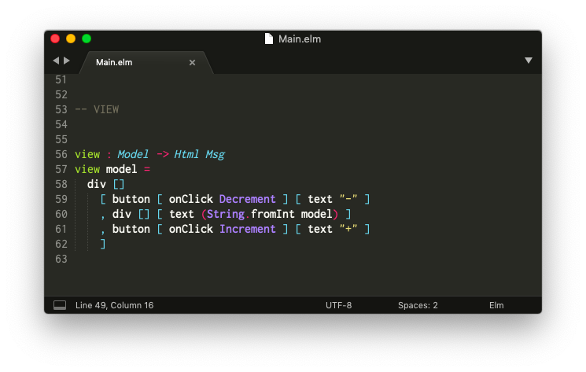

There are a bunch of editor plugins maintained by community members for a broad range of editors. You can check out a list of them [here](https://github.com/elm/editor-plugins).

It can be tricky to get an editor set up, so for the purpose of this guide, I am going to show how to get set up with Sublime Text in particular. Hopefully this will be helpful for people new to programming or as a backup for people who already have a preferred code editor.


### Sublime Text

**Step 1:** Download Sublime Text from [here](https://www.sublimetext.com/).

**Step 2:** Install the "Elm Syntax Highlighting" plugin.

- [Mac](https://github.com/evancz/elm-syntax-highlighting/blob/master/install/mac.md)
- [Linux](https://github.com/evancz/elm-syntax-highlighting/blob/master/install/linux.md)
- [Windows](https://github.com/evancz/elm-syntax-highlighting/blob/master/install/windows.md)

After going through those steps, it should be possible to open Elm files with syntax highlighting. Keywords like `import` and `type` should be colorful so the code is easier to read.


> **Note:** There are alternatives! Community members have created editor plugins for Atom, Emacs, IntelliJ, Vim, VS Code, and many more. We try to keep [this page](https://github.com/elm/editor-plugins) up to date with all the options!


### Install Elm

The previous page described how to install a code editor for Elm, so the next step is to obtain an executable file named `elm`. Here are the **install** links:

- **Mac** - [installer](https://github.com/elm/compiler/releases/download/0.19.3/installer-for-mac.pkg)
- **Linux** - <a href="https://github.com/elm/compiler/blob/main/installers/linux/README.md" target="_blank">instructions</a>
- **Windows** - [installer](https://github.com/elm/compiler/releases/download/0.19.3/installer-for-windows.exe)

After installation is complete, open up the terminal on your computer. It may be called `cmd.exe` or `Command Prompt` on Windows.

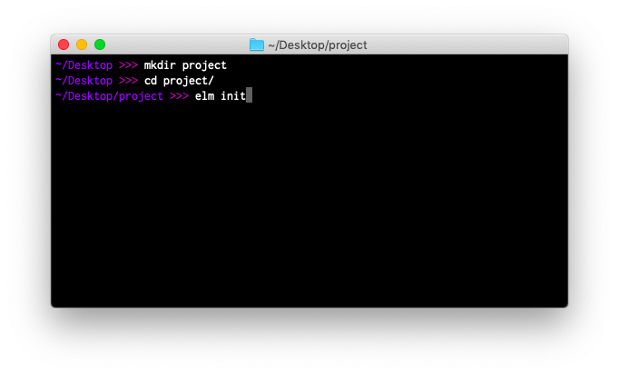

Start by navigating to your desktop in the terminal:

```bash
# Mac and Linux
cd ~/Desktop

# Windows (but with <username> filled in with your user name)
cd C:\Users\<username>\Desktop
```

The next step is to get familiar with `elm` command. I personally had a really hard time learning terminal commands, so I worked hard to make the `elm` command nice to use. Let's go through a couple common scenarios.


### `elm init`

You can start an Elm project by running:

```bash
elm init
```

Try running this command to create an `elm.json` file and a `src/` directory:

- [`elm.json`](https://github.com/elm/compiler/blob/main/docs/elm.json/application.md) describes your project.
- `src/` holds all of your Elm files.

Now try creating a file called `src/Main.elm` in your editor, and copying in the code from [the buttons example](https://elm-lang.org/examples/buttons).


### `elm reactor`

`elm reactor` helps you build Elm projects without messing with the terminal too much. You just run it at the root of your project, like this:

```bash
elm reactor
```

This starts a server at [`http://localhost:8000`](http://localhost:8000). You can navigate to any Elm file and see what it looks like. Run `elm reactor`, follow the localhost link, and try to check out your `src/Main.elm` file!


### `elm make`

You can compile Elm code to HTML or JavaScript with commands like this:

```bash
# Create an index.html file that you can open in your browser.
elm make src/Main.elm

# Create an optimized JS file to embed in a custom HTML document.
elm make src/Main.elm --optimize --output=elm.js
```

Try running these commands on your `src/Main.elm` file.

This is the most general way to compile Elm code. It is extremely useful once your project becomes too advanced for `elm reactor`.

This command produces the same messages you have been seeing in the online editor and with `elm reactor`. Years of work has gone into them so far, but please report any unhelpful messages [here](https://github.com/elm/error-message-catalog/issues). I am sure there are ways to improve!


### `elm install`

Elm packages all live at [`package.elm-lang.org`](https://package.elm-lang.org/).

Say you look around and decide you need [`elm/http`](https://package.elm-lang.org/packages/elm/http/latest) and [`elm/json`](https://package.elm-lang.org/packages/elm/json/latest) to make some HTTP requests. You can get them set up in your project with the following commands:

```bash
elm install elm/http
elm install elm/json
```

This adds these dependencies into your `elm.json` file, making these packages available in your project. That will let you say `import Http` and use functions like `Http.get` in your programs.


### Tips and Tricks

**First**, do not worry about remembering all this stuff!

You can always run `elm --help` to get a full outline of what `elm` is capable of.

You can also run commands like `elm make --help` and `elm repl --help` to get hints about a specific command. This is great if you want to check which flags are available and what they do.

**Second**, do not worry if it takes some time to get comfortable with the terminal in general.

I have been using it for over a decade now, and I still cannot remember how to compress files, find all Elm files in a directory, etc. I still look a lot of things up!

* * *

Now that we have our editor set up and `elm` available in the terminal, let's get back to learning Elm!


## JavaScript Interop

By now we have seen **The Elm Architecture**, **types**, **commands**, **subscriptions**, and we even have Elm installed locally.

But what happens when you need to integrate with JavaScript? Maybe there is a browser API that does not have an equivalent Elm package yet. Maybe you want to embed a JavaScript widget within your Elm app? Etc. This chapter will outline Elm's three interop mechanisms:

- [Flags](#flags)
- [Ports](#ports)
- [Custom Elements](#custom-elements)

Before we get into the three mechanisms, we need to know how to compile Elm programs to JavaScript!

> **NOTE:** If you are evaluating Elm for use at work, I encourage you to make sure these three mechanisms will be able to cover all of your needs. You can get a quick overview of this chapter by looking at these [examples](https://github.com/elm-community/js-integration-examples/). Please ask [here](https://discourse.elm-lang.org/) if you are not sure about something, and I encourage you to circle back to Elm later if you are not fully confident.


### Compiling to JavaScript

Running `elm make` produces HTML files by default. So if you say:

```bash
elm make src/Main.elm
```

It produces an `index.html` file that you can just open and start playing with. If you are getting into JavaScript interop, you want to produce JavaScript files instead:

```bash
elm make src/Main.elm --output=main.js
```

This produces a JavaScript file that exposes an `Elm.Main.init()` function. So once you have `main.js` you can write your own HTML file that does whatever you want.


### Embedding in HTML

Here is the minimal HTML needed to make your `main.js` appear in a browser:

```html
<html>
<head>
  <meta charset="UTF-8">
  <title>Main</title>
  <script src="main.js"></script>
</head>

<body>
  <div id="myapp"></div>
  <script>
  var app = Elm.Main.init({
    node: document.getElementById('myapp')
  });
  </script>
</body>
</html>
```

I want to call attention to the important lines here:

- `<head>` - We have a line to load our compiled `main.js` file. This is required! If you compile an Elm module called `Main`, you will get an `Elm.Main.init()` function available in JavaScript. If you compile an Elm module named `Home`, you will get an `Elm.Home.init()` function in JavaScript. Etc.

- `<body>` - We need to do two things here. First, we create a `<div>` that we want our Elm program to take over. Maybe it is within a larger application, surrounded by tons of other stuff? That is fine! Second, we have a `<script>` to initialize our Elm program. Here we call the `Elm.Main.init()` function to start our program, passing in the `node` we want to take over.

Now that we know how to embed Elm programs in an HTML document, it is time to start exploring the three interop options: flags, ports, and custom elements!

> **Note:** This is a normal HTML file, so you can put whatever you want in it! Many people load additional JS and CSS files in the `<head>`. That means it is totally fine to write your CSS by hand or to generate it somehow. Add something like `<link rel="stylesheet" href="whatever-you-want.css">` in your `<head>` and you have access to it. (There are some great options for specifying your CSS all _within_ Elm as well, but that is a whole other topic!)


### Flags

Flags are a way to pass values into Elm on initialization.

Common uses are passing in API keys, environment variables, and user data. This can be handy if you generate the HTML dynamically. They can also help us load cached information in [this `localStorage` example](https://github.com/elm-community/js-integration-examples/tree/master/localStorage).


### Flags in HTML

The HTML is basically the same as before, but with an additional `flags` argument to the `Elm.Main.init()` function

```html
<html>
<head>
  <meta charset="UTF-8">
  <title>Main</title>
  <script src="main.js"></script>
</head>

<body>
  <div id="myapp"></div>
  <script>
  var app = Elm.Main.init({
    node: document.getElementById('myapp'),
    flags: Date.now()
  });
  </script>
</body>
</html>
```

In this example we are passing in the current time in milliseconds, but any JS value that can be JSON decoded can be given as a flag.

> **Note:** This additional data is called “flags” because it is kind of like command line flags. You can call `elm make src/Main.elm`, but you can add some flags like `--optimize` and `--output=main.js` to customize its behavior. Same sort of thing.


### Flags in Elm

To handle flags on the Elm side, you need to modify your `init` function a bit:

```elm
module Main exposing (..)

import Browser
import Html exposing (Html, text)


-- MAIN

main : Program Int Model Msg
main =
  Browser.element
    { init = init
    , view = view
    , update = update
    , subscriptions = subscriptions
    }


-- MODEL

type alias Model = { currentTime : Int }

init : Int -> ( Model, Cmd Msg )
init currentTime =
  ( { currentTime = currentTime }
  , Cmd.none
  )


-- UPDATE

type Msg = NoOp

update : Msg -> Model -> ( Model, Cmd Msg )
update _ model =
  ( model, Cmd.none )


-- VIEW

view : Model -> Html Msg
view model =
  text (String.fromInt model.currentTime)


-- SUBSCRIPTIONS

subscriptions : Model -> Sub Msg
subscriptions _ =
  Sub.none
```
``` html -index.html
<html>
<head>
  <meta charset="UTF-8">
  <title>Main</title>
  <script src="main.js"></script>
</head>

<body>
  <div id="myapp"></div>
  <script>
  var app = Elm.Main.init({
    node: document.getElementById('myapp'),
    flags: Date.now()
  });
  </script>
</body>
</html>
```
@Elm.eval

The only important here is the `init` function says it takes an `Int` argument. This is how Elm code gets immediate access to the flags you pass in from JavaScript. From there, you can put things in your model or run some commands. Whatever you need to do.

I recommend checking out [this `localStorage` example](https://github.com/elm-community/js-integration-examples/tree/master/localStorage) for a more interesting use of flags!


### Verifying Flags

But what happens if `init` says it takes an `Int` flag, but someone tries to initialize with `Elm.Main.init({ flags: "haha, what now?" })`?

Elm checks for that sort of thing, making sure the flags are exactly what you expect. Without this check, you could pass in anything, leading to runtime errors in Elm!

There are a bunch of types that can be given as flags:

- `Bool`
- `Int`
- `Float`
- `String`
- `Maybe`
- `List`
- `Array`
- tuples
- records
- [`Json.Decode.Value`](https://package.elm-lang.org/packages/elm/json/latest/Json-Decode#Value)

Many folks always use a `Json.Decode.Value` because it gives them really precise control. They can write a decoder to handle any weird scenarios in Elm code, recovering from unexpected data in a nice way.

The other supported types actually come from before we had figured out a way to do JSON decoders. If you choose to use them, there are some subtleties to be aware of. The following examples show the desired flag type, and then the sub-points show what would happen with a couple different JS values:

- `init : Int -> ...`
  - `0` => `0`
  - `7` => `7`
  - `3.14` => error
  - `6.12` => error

- `init : Maybe Int -> ...`
  - `null` => `Nothing`
  - `42` => `Just 42`
  - `"hi"` => error

- `init : { x : Float, y : Float } -> ...`
  - `{ x: 3, y: 4, z: 50 }` => `{ x = 3, y = 4 }`
  - `{ x: 3, name: "Tom" }` => error
  - `{ x: 360, y: "why?" }` => error

- `init : (String, Int) -> ...`
  - `["Tom", 42]` => `("Tom", 42)`
  - `["Sue", 33]` => `("Sue", 33)`
  - `["Bob", "4"]` => error
  - `["Joe", 9, 9]` => error

Note that when one of the conversions goes wrong, **you get an error on the JS side!** We are taking the “fail fast” policy. Rather than the error making its way through Elm code, it is reported as soon as possible. This is another reason why people like to use `Json.Decode.Value` for flags. Instead of getting an error in JS, the weird value goes through a decoder, guaranteeing that you implement some sort of fallback behavior.


### Ports

Ports allow communication between Elm and JavaScript.

Ports are probably most commonly used for [`WebSockets`](https://github.com/elm-community/js-integration-examples/tree/master/websockets) and [`localStorage`](https://github.com/elm-community/js-integration-examples/tree/master/localStorage). Let's focus on the `WebSockets` example.


### Ports in JavaScript

Here we have pretty much the same HTML we have been using on the previous pages, but with a bit of extra JavaScript code in there. We create a connection to `wss://echo.websocket.org` that just repeats back whatever you send it. You can see in the [live example](https://ellie-app.com/8yYgw7y7sM2a1) that this lets us make the skeleton of a chat room:

```html
<!DOCTYPE HTML>
<html>

<head>
  <meta charset="UTF-8">
  <title>Elm + Websockets</title>
  <script type="text/javascript" src="elm.js"></script>
</head>

<body>
	<div id="myapp"></div>
</body>

<script type="text/javascript">

// Start the Elm application.
var app = Elm.Main.init({
	node: document.getElementById('myapp')
});

// Create your WebSocket.
var socket = new WebSocket('wss://echo.websocket.org');

// When a command goes to the `sendMessage` port, we pass the message
// along to the WebSocket.
app.ports.sendMessage.subscribe(function(message) {
    socket.send(message);
});

// When a message comes into our WebSocket, we pass the message along
// to the `messageReceiver` port.
socket.addEventListener("message", function(event) {
	app.ports.messageReceiver.send(event.data);
});

// If you want to use a JavaScript library to manage your WebSocket
// connection, replace the code in JS with the alternate implementation.
</script>

</html>
```

We call `Elm.Main.init()` like in all of our interop examples, but this time we are actually using the resulting `app` object. We are subscribing to the `sendMessage` port and we are sending to the `messageReceiver` port.

Those correspond to code written on the Elm side.


### Ports in Elm

Check out the lines that use the `port` keyword in the corresponding Elm file. This is how we define the ports that we just saw on the JavaScript side.

```elm
port module Main exposing (..)

import Browser
import Html exposing (..)
import Html.Attributes exposing (..)
import Html.Events exposing (..)
import Json.Decode as D


-- MAIN


main : Program () Model Msg
main =
  Browser.element
    { init = init
    , view = view
    , update = update
    , subscriptions = subscriptions
    }


-- PORTS


port sendMessage : String -> Cmd msg
port messageReceiver : (String -> msg) -> Sub msg


-- MODEL


type alias Model =
  { draft : String
  , messages : List String
  }


init : () -> ( Model, Cmd Msg )
init flags =
  ( { draft = "", messages = [] }
  , Cmd.none
  )


-- UPDATE


type Msg
  = DraftChanged String
  | Send
  | Recv String


-- Use the `sendMessage` port when someone presses ENTER or clicks
-- the "Send" button. Check out index.html to see the corresponding
-- JS where this is piped into a WebSocket.
--
update : Msg -> Model -> ( Model, Cmd Msg )
update msg model =
  case msg of
    DraftChanged draft ->
      ( { model | draft = draft }
      , Cmd.none
      )

    Send ->
      ( { model | draft = "" }
      , sendMessage model.draft
      )

    Recv message ->
      ( { model | messages = model.messages ++ [message] }
      , Cmd.none
      )


-- SUBSCRIPTIONS


-- Subscribe to the `messageReceiver` port to hear about messages coming in
-- from JS. Check out the index.html file to see how this is hooked up to a
-- WebSocket.
--
subscriptions : Model -> Sub Msg
subscriptions _ =
  messageReceiver Recv


-- VIEW


view : Model -> Html Msg
view model =
  div []
    [ h1 [] [ text "Echo Chat" ]
    , ul []
        (List.map (\msg -> li [] [ text msg ]) model.messages)
    , input
        [ type_ "text"
        , placeholder "Draft"
        , onInput DraftChanged
        , on "keydown" (ifIsEnter Send)
        , value model.draft
        ]
        []
    , button [ onClick Send ] [ text "Send" ]
    ]


-- DETECT ENTER


ifIsEnter : msg -> D.Decoder msg
ifIsEnter msg =
  D.field "key" D.string
    |> D.andThen (\key -> if key == "Enter" then D.succeed msg else D.fail "some other key")
```
``` html -index.html
<!DOCTYPE HTML>
<html>

<head>
  <meta charset="UTF-8">
  <title>Elm + Websockets</title>
  <script type="text/javascript" src="elm.js"></script>
</head>

<body>
	<div id="myapp"></div>
</body>

<script type="text/javascript">

// Start the Elm application.
var app = Elm.Main.init({
	node: document.getElementById('myapp')
});

// Create your WebSocket.
var socket = new WebSocket('wss://echo.websocket.org');

// When a command goes to the `sendMessage` port, we pass the message
// along to the WebSocket.
app.ports.sendMessage.subscribe(function(message) {
    socket.send(message);
});

// When a message comes into our WebSocket, we pass the message along
// to the `messageReceiver` port.
socket.addEventListener("message", function(event) {
	app.ports.messageReceiver.send(event.data);
});

// If you want to use a JavaScript library to manage your WebSocket
// connection, replace the code in JS with the alternate implementation.
</script>

</html>
```
@Elm.eval

Notice that the first line says `port module` rather than just `module`. This makes it possible to define ports in a given module. The compiler gives a hint about this if it is needed, so hopefully no one gets too stuck on that!

Okay, but what is going on with the `port` declarations for `sendMessage` and `messageReceiver`?


### Outgoing Messages (`Cmd`)

The `sendMessage` declaration lets us send messages out of Elm.

```elm
port sendMessage : String -> Cmd msg
```

Here we are declaring that we want to send out `String` values, but we could send out any of the types that work with flags. We talked about those types on the previous page, and you can check out [this `localStorage` example](https://ellie-app.com/8yYddD6HRYJa1) to see a [`Json.Encode.Value`](https://package.elm-lang.org/packages/elm/json/latest/Json-Encode#Value) getting sent out to JavaScript.

From there we can use `sendMessage` like any other function. If your `update` function produces a `sendMessage "hello"` command, you will hear about it on the JavaScript side:

```javascript
app.ports.sendMessage.subscribe(function(message) {
    socket.send(message);
});
```

This JavaScript code is subscribed to all of the outgoing messages. You can `subscribe` multiple functions and `unsubscribe` functions by reference, but we generally recommend keeping things static.

We also recommend sending out richer messages, rather than making lots of individual ports. Maybe that means having a custom type in Elm that represents everything you might need to tell JS, and then using [`Json.Encode`](https://package.elm-lang.org/packages/elm/json/latest/Json-Encode) to send it out to a single JS subscription. Many people find that this creates a cleaner separation of concerns. The Elm code clearly owns some state, and the JS clearly owns other state.


### Incoming Messages (`Sub`)

The `messageReceiver` declaration lets us listen for messages coming in to Elm.

```elm
port messageReceiver : (String -> msg) -> Sub msg
```

We are saying we are going to receive `String` values, but again, we can listen for any type that can come in through flags or outgoing ports. Just swap out the `String` type with one of the types that can cross the border.

Again we can use `messageReceiver` like any other function. In our case we call `messageReceiver Recv` when defining our `subscriptions` because we want to hear about any incoming messages from JavaScript. This will let us get messages like `Recv "how are you?"` in our `update` function.

On the JavaScript side, we are able to send things to this port whenever we want:

```javascript
socket.addEventListener("message", function(event) {
	app.ports.messageReceiver.send(event.data);
});
```

We happen to be sending whenever the websocket gets a message, but you could send at other times as well. Maybe we are getting messages from another data source as well. That is fine, and Elm does not need to know anything about it! Just send the strings through the relevant port.


### Notes

**Ports are about creating strong boundaries!** Definitely do not try to make a port for every JS function you need. You may really like Elm and want to do everything in Elm no matter the cost, but ports are not designed for that. Instead, focus on questions like “who owns the state?” and use one or two ports to send messages back and forth. If you are in a complex scenario, you can even simulate `Msg` values by sending JS like `{ tag: "active-users-changed", list: ... }` where you have a tag for all the variants of information you might send across.

Here are some simple guidelines and common pitfalls:

- **Sending `Json.Encode.Value` through ports is recommended.** Like with flags, certain core types can pass through ports as well. This is from the time before JSON decoders, and you can read about it more [here](#verifying-flags).

- **All `port` declarations must appear in a `port module`.** It is probably best to organize all your ports into one `port module` so it is easier to see the interface all in one place.

- **Ports are for applications.** A `port module` is available in applications, but not in packages. This ensures that application authors have the flexibility they need, but the package ecosystem is entirely written in Elm. We think this will create a stronger ecosystem and community in the long run, and we get into the tradeoffs in depth in the upcoming section on the [limits](#the-limits-of-elm/js-interop) of Elm/JS interop.

- **Ports can be dead code eliminated.** Elm has quite aggressive [dead code elimination](https://en.wikipedia.org/wiki/Dead_code_elimination), and it will remove ports that are not used within Elm code. The compiler does not know what goes on in JavaScript, so try to hook things up in Elm before JavaScript.

I hope this information will help you find ways to embed Elm in your existing JavaScript! It is not as glamorous as doing a full-rewrite in Elm, but history has shown that it is a much more effective strategy.


### Custom Elements

On the last few pages, we have seen (1) how to start Elm programs from JavaScript, (2) how to pass data in as flags on initialization, and (3) how to send messages between Elm and JS with ports. But guess what people? There is another way to do interop!

Browsers seem to be supporting [custom elements](https://developer.mozilla.org/en-US/docs/Web/Web_Components/Using_custom_elements) more and more, and that turns out to be quite helpful for embedding JS into Elm programs.

Here is a [minimal example](https://github.com/elm-community/js-integration-examples/tree/master/internationalization) of how to use custom elements to do some localization and internationalization.


### Creating Custom Elements

Say we want to localize dates, but that is not accessible in Elm core packages yet. Maybe you want to write a function that localizes dates:

```javascript
//
//   localizeDate('sr-RS', 12, 5) === "петак, 1. јун 2012."
//   localizeDate('en-GB', 12, 5) === "Friday, 1 June 2012"
//   localizeDate('en-US', 12, 5) === "Friday, June 1, 2012"
//
function localizeDate(lang, year, month)
{
	const dateTimeFormat = new Intl.DateTimeFormat(lang, {
		weekday: 'long',
		year: 'numeric',
		month: 'long',
		day: 'numeric'
	});

	return dateTimeFormat.format(new Date(year, month));
}
```

But how do we use that in Elm?! Newer browsers allow you to create new types of DOM nodes like this:

```javascript
//
//   <intl-date lang="sr-RS" year="2012" month="5">
//   <intl-date lang="en-GB" year="2012" month="5">
//   <intl-date lang="en-US" year="2012" month="5">
//
customElements.define('intl-date',
	class extends HTMLElement {
		// things required by Custom Elements
		constructor() { super(); }
		connectedCallback() { this.setTextContent(); }
		attributeChangedCallback() { this.setTextContent(); }
		static get observedAttributes() { return ['lang','year','month']; }

		// Our function to set the textContent based on attributes.
		setTextContent()
		{
			const lang = this.getAttribute('lang');
			const year = this.getAttribute('year');
			const month = this.getAttribute('month');
			this.textContent = localizeDate(lang, year, month);
		}
	}
);
```

The most important parts here are `attributeChangedCallback` and `observedAttributes`. You need some logic like that to detect changes to the attributes you care about.

Load that before you initialize your Elm code, and you will be able to write code like this in Elm:

```elm
import Html exposing (Html, node)
import Html.Attributes (attribute)

viewDate : String -> Int -> Int -> Html msg
viewDate lang year month =
  node "intl-date"
    [ attribute "lang" lang
    , attribute "year" (String.fromInt year)
    , attribute "month" (String.fromInt month)
    ]
    []
```

Now you can call `viewDate` when you want access to that kind of localized information in your `view`.

You can check out the full version of this example [here](https://github.com/elm-community/js-integration-examples/tree/master/internationalization).


### More Info

Luke has a lot more experience with custom elements, and I think his Elm Europe talk is an excellent introduction!

!?[](https://www.youtube.com/watch?v=tyFe9Pw6TVE)

Docs on custom elements can be kind of confusing, but I hope this is enough for people to get started embedding simple logic for `Intl` or even large React widgets if that seems like the right choice for your project.


### The Limits of Elm/JS Interop

Many languages have a Foreign Function Interface (FFI) that allows direct bindings functions in the host language. For example, Scala can call Java functions directly. Same with Clojure/Java, Python/C, Haskell/C, and many others.

**Elm does not have a traditional Foreign Function Interface with JavaScript.** It is not possible to call arbitrary JavaScript functions at any time. This has tradeoffs that some people really love, but it is not for everyone! If you are evaluating Elm for commercial use, I highly encourage you to look through [these interop examples](https://github.com/elm-community/js-integration-examples) to get a feeling for whether flags, ports, and custom elements can cover everything you need.

Why does Elm make a different choice than other languages on this?


### Tradeoffs

Ports are somewhat of an outlier in the history of languages. There are two common interop strategies, and Elm did neither of them:

1. **Full backwards compatibility.** For example, C++ is a superset of C, and TypeScript is a superset of JavaScript. This is the most permissive approach, and it has proven extremely effective. By definition, everyone is using your language already.
2. **Foreign function interface (FFI)** This allows direct bindings to functions in the host language. For example, Scala can call Java functions directly. Same with Clojure/Java, Python/C, Haskell/C, and many others. Again, this has proven quite effective.

These paths are attractive for faster adoption and greater flexibility, but they are not ideal for Elm for two main reasons:

1. **Losing Guarantees.** One of the best things about Elm is that there are entire categories of problems you just do not have to worry about. There are no surprise exceptions to catch, and functions cannot mutate data in surprising ways. I think this is the core value of Elm over alternative languages, but if we can call JS directly, all that goes away. Does this package produce runtime exceptions? When? Will it mutate the values I give to it? Do I need to detect that? Does the package have side-effects? Will it send messages to some 3rd party servers? Log passwords? A decent chunk of Elm users are drawn to the language specifically because they do not have to think like that anymore.
2. **Package Flooding.** There is quite high demand to directly copy JavaScript APIs into Elm. In the two years before `elm/html` existed, I am sure someone would have contributed jQuery bindings if it was possible. This has already happened in the typed functional languages that compile to JS, but have more traditional interop designs. As far as I know, package flooding is somewhat unique to compile-to-JS languages. The pressure is not nearly as high in Python for example, so I think that downside is a product of the unique culture and history of the JavaScript ecosystem.

Given these pitfalls, ports and custom elements are attractive because they let you get things done in JavaScript while preserving the best parts of Elm. Great! On the flip side, it means Elm cannot piggyback on the JS ecosystem to gain more libraries more quickly. If you take a longer-view, I think this is actually a key strength. As a result:

1. **Packages are designed for Elm.** As members of the Elm community get more experience and confidence, we are starting to see fresh approaches to layout and data visualization that work seamlessly with The Elm Architecture and the overall ecosystem. I expect this to keep happening with other sorts of problems!
2. **Code is portable.** If the compiler someday produces x86 or WebAssembly, the whole ecosystem just keeps working, but faster! Ports guarantee that all packages are written entirely in Elm, and Elm itself was designed such that other non-JS compiler targets are viable.
3. **Packages are more secure.** Languages like JavaScript have serious security concerns with packages. Reports of [stealing credentials](https://www.bleepingcomputer.com/news/security/compromised-javascript-package-caught-stealing-npm-credentials/) and [stealing API keys](https://winbuzzer.com/2020/01/14/microsoft-discovers-an-npm-package-thats-been-stealing-unix-user-data-xcxwbn/) are not uncommon, imposing a permanent auditing cost on all packages. Do they add a keylogger to `window`? Elm packages can guarantee that entire categories of exploits just cannot happen, reducing auditing cost and security risks overall.
4. **Optimization is easier.** The style of generated code has changed significantly from release to release in the past. For example, the [0.19 release](https://elm-lang.org/news/small-assets-without-the-headache) was able to dramatically reduce asset size by (1) generating code in a way that works better with JavaScript minifiers and (2) using different runtime representations of custom types depending on your optimization level. I expect it will change again for code slicing or if we find a faster calling convention for currying. Furthermore, the compiler can safely assume that all code is pure, which may allow it to move code around more aggressively than other compilers. Locking into a specific calling convention now is likely to make some of these optimizations impossible.

This is definitely a longer and harder path, but languages live for 30+ years. They have to support teams and companies for decades, and when I think about what Elm will look like in 20 or 30 years, I think the trade-offs that come with ports look really promising! My talk [What is Success?](https://youtu.be/uGlzRt-FYto) starts a little slow, but it gets into this a bit more!

And again, this path is not for everyone! There are many alternative languages that have a traditional FFI instead, and I encourage you to look into those languages if you think that path might be better. Is the package ecosystem as cohesive? Do you get runtime exceptions more often? Maybe, but maybe the extra flexibility is worth it for you. So I encourage you to take a look at [these interop examples](https://github.com/elm-community/js-integration-examples) to decide if flags, ports, and custom elements will cover everything you need. This is especially important if you are considering Elm for commercial use!


## Web Apps

So far we have been creating Elm programs with `Browser.element`, allowing us to take over a single node in a larger application. This is great for _introducing_ Elm at work (as described [here](https://elm-lang.org/blog/how-to-use-elm-at-work)) but what happens after that? How can we use Elm more extensively?

In this chapter, we will learn how to create a “web app” with a bunch of different pages that all integrate nicely with each other, but we must start by controlling a single page.


### Control the Document

The first step is to switch to starting programs with [`Browser.document`](https://package.elm-lang.org/packages/elm/browser/latest/Browser#document):

```elm
document :
  { init : flags -> ( model, Cmd msg )
  , view : model -> Document msg
  , update : msg -> model -> ( model, Cmd msg )
  , subscriptions : model -> Sub msg
  }
  -> Program flags model msg
```

The arguments are almost exactly the same as `Browser.element`, except for the `view` function. Rather than returning an `Html` value, you return a [`Document`](https://package.elm-lang.org/packages/elm/browser/latest/Browser#Document) like this:

```elm
type alias Document msg =
  { title : String
  , body : List (Html msg)
  }
```

This gives you control over the `<title>` and the `<body>` of the document. Perhaps your program downloads some data and that helps you determine a more specific title. Now you can just change it in your `view` function!


### Serve the Page

The compiler produces HTML by default, so you can compile your code like this:

```bash
elm make src/Main.elm
```

The output will be a file named `index.html` that you can serve like any other HTML file. That works fine, but you can get a bit more flexibility by (1) compiling Elm to JavaScript and (2) making your own custom HTML file. To take that path, you compile like this:

```bash
elm make src/Main.elm --output=main.js
```

This will produce `main.js` which you can load from a custom HTML file like this:

```html
<!DOCTYPE HTML>
<html>
<head>
  <meta charset="UTF-8">
  <title>Main</title>
  <link rel="stylesheet" href="whatever-you-want.css">
  <script src="main.js"></script>
</head>
<body>
  <script>var app = Elm.Main.init();</script>
</body>
</html>
```

This HTML is pretty simple. You load whatever you need in the `<head>` and you initialize your Elm program in the `<body>`. The Elm program will take it from there and render everything.

Either way, now you have some HTML that you can send to browsers. You can get that HTML to people with free services like [GitHub Pages](https://pages.github.com/) or [Netlify](https://www.netlify.com/), or maybe you make your own server and run a VPS with a service like [Digital Ocean](https://m.do.co/c/c47faa1916d2). Whatever works for you! You just need a way to get HTML into a browser.

> **Note 1:** Creating custom HTML is helpful if you are doing something custom with CSS. Many people use projects like [`rtfeldman/elm-css`](https://package.elm-lang.org/packages/rtfeldman/elm-css/latest/) to handle all of their styles from within Elm, but maybe you are working in a team where there is lots of predefined CSS. Maybe the team is even using one of those CSS preprocessors. That is all fine. Just load the final CSS file in the `<head>` of your HTML file.
>
> **Note 2:** The Digital Ocean link above is a referral link, so if you sign up through that and end up using the service, we get a \$25 credit towards our hosting costs for `elm-lang.org` and `package.elm-lang.org`.


### Navigation

We just saw how to serve one page, but say we are making a website like `package.elm-lang.org`. It has a bunch of pages (e.g. [search](https://package.elm-lang.org/), [README](https://package.elm-lang.org/packages/elm/core/latest/), [docs](https://package.elm-lang.org/packages/elm/core/latest/Maybe)) that all work differently. How does it do that?


### Multiple Pages

The simple way would be to serve a bunch of different HTML files. Going to the home page? Load new HTML. Going to `elm/core` docs? Load new HTML. Going to `elm/json` docs? Load new HTML.

Until Elm 0.19, that is exactly what the package website did! It works. It is simple. But it has some weaknesses:

1. **Blank Screens.** The screen goes white every time you load new HTML. Can we do a nice transition instead?
2. **Redundant Requests.** Each package has a single `docs.json` file, but it gets loaded each time you visit a module like [`String`](https://package.elm-lang.org/packages/elm/core/latest/String) or [`Maybe`](https://package.elm-lang.org/packages/elm/core/latest/Maybe). Can we share the data between pages somehow?
3. **Redundant Code.** The home page and the docs share a lot of functions, like `Html.text` and `Html.div`. Can this code be shared between pages?

We can improve all three cases! The basic idea is to only load HTML once, and then be a bit tricky to handle URL changes.


### Single Page

Instead of creating our program with `Browser.element` or `Browser.document`, we can create a [`Browser.application`](https://package.elm-lang.org/packages/elm/browser/latest/Browser#application) to avoid loading new HTML when the URL changes:

```elm
application :
  { init : flags -> Url -> Key -> ( model, Cmd msg )
  , view : model -> Document msg
  , update : msg -> model -> ( model, Cmd msg )
  , subscriptions : model -> Sub msg
  , onUrlRequest : UrlRequest -> msg
  , onUrlChange : Url -> msg
  }
  -> Program flags model msg
```

It extends the functionality of `Browser.document` in three important scenarios.

**When the application starts**, `init` gets the current [`Url`](https://package.elm-lang.org/packages/elm/url/latest/Url#Url) from the browsers navigation bar. This allows you to show different things depending on the `Url`.

**When someone clicks a link**, like `<a href="/home">Home</a>`, it is intercepted as a [`UrlRequest`](https://package.elm-lang.org/packages/elm/browser/latest/Browser#UrlRequest). So instead of loading new HTML with all the downsides, `onUrlRequest` creates a message for your `update` where you can decide exactly what to do next. You can save scroll position, persist data, change the URL yourself, etc.

**When the URL changes**, the new `Url` is sent to `onUrlChange`.
The resulting message goes to `update` where you can decide how to show the new page.

So rather than loading new HTML, these three additions give you full control over URL changes. Let’s see it in action!

### Example

We will start with the baseline `Browser.application` program. It just keeps track of the current URL. Skim through the code now! Pretty much all of the new and interesting stuff happens in the `update` function, and we will get into those details after the code:


```elm
import Browser
import Browser.Navigation as Nav
import Html exposing (..)
import Html.Attributes exposing (..)
import Url


-- MAIN


main : Program () Model Msg
main =
  Browser.application
    { init = init
    , view = view
    , update = update
    , subscriptions = subscriptions
    , onUrlChange = UrlChanged
    , onUrlRequest = LinkClicked
    }


-- MODEL


type alias Model =
  { key : Nav.Key
  , url : Url.Url
  }


init : () -> Url.Url -> Nav.Key -> ( Model, Cmd Msg )
init flags url key =
  ( Model key url, Cmd.none )


-- UPDATE


type Msg
  = LinkClicked Browser.UrlRequest
  | UrlChanged Url.Url


update : Msg -> Model -> ( Model, Cmd Msg )
update msg model =
  case msg of
    LinkClicked urlRequest ->
      case urlRequest of
        Browser.Internal url ->
          ( model, Nav.pushUrl model.key (Url.toString url) )

        Browser.External href ->
          ( model, Nav.load href )

    UrlChanged url ->
      ( { model | url = url }
      , Cmd.none
      )


-- SUBSCRIPTIONS


subscriptions : Model -> Sub Msg
subscriptions _ =
  Sub.none


-- VIEW


view : Model -> Browser.Document Msg
view model =
  { title = "URL Interceptor"
  , body =
      [ text "The current URL is: "
      , b [] [ text (Url.toString model.url) ]
      , ul []
          [ viewLink "/home"
          , viewLink "/profile"
          , viewLink "/reviews/the-century-of-the-self"
          , viewLink "/reviews/public-opinion"
          , viewLink "/reviews/shah-of-shahs"
          ]
      ]
  }


viewLink : String -> Html msg
viewLink path =
  li [] [ a [ href path ] [ text path ] ]
```
@Elm.eval

The `update` function can handle either `LinkClicked` or `UrlChanged` messages. There is a lot of new stuff in the `LinkClicked` branch, so we will focus on that first!


### `UrlRequest`

Whenever someone clicks a link like `<a href="/home">/home</a>`, it produces a `UrlRequest` value:

```elm
type UrlRequest
  = Internal Url.Url
  | External String
```

The `Internal` variant is for any link that stays on the same domain. So if you are browsing `https://example.com`, internal links include things like `settings#privacy`, `/home`, `https://example.com/home`, and `//example.com/home`.

The `External` variant is for any link that goes to a different domain. Links like `https://elm-lang.org/examples`, `https://static.example.com`, and `http://example.com/home` all go to a different domain. Notice that changing the protocol from `https` to `http` is considered a different domain!

Whichever link someone presses, our example program is going to create a `LinkClicked` message and send it to the `update` function. That is where we see most of the interesting new code!


### `LinkClicked`

Most of our `update` logic is deciding what to do with these `UrlRequest` values:

```elm
update : Msg -> Model -> ( Model, Cmd Msg )
update msg model =
  case msg of
    LinkClicked urlRequest ->
      case urlRequest of
        Browser.Internal url ->
          ( model, Nav.pushUrl model.key (Url.toString url) )

        Browser.External href ->
          ( model, Nav.load href )

    UrlChanged url ->
      ( { model | url = url }
      , Cmd.none
      )
```

The particularly interesting functions are `Nav.load` and `Nav.pushUrl`. These are both from the [`Browser.Navigation`](https://package.elm-lang.org/packages/elm/browser/latest/Browser-Navigation) module which is all about changing the URL in different ways. We are using the two most common functions from that module:

- [`load`](https://package.elm-lang.org/packages/elm/browser/latest/Browser-Navigation#load) loads all new HTML. It is equivalent to typing the URL into the URL bar and pressing enter. So whatever is happening in your `Model` will be thrown out, and a whole new page is loaded.
- [`pushUrl`](https://package.elm-lang.org/packages/elm/browser/latest/Browser-Navigation#pushUrl) changes the URL, but does not load new HTML. Instead it triggers a `UrlChanged` message that we handle ourselves! It also adds an entry to the “browser history” so things work normal when people press the `BACK` or `FORWARD` buttons.

So looking back at the `update` function, we can understand how it all fits together a bit better now. When the user clicks a `https://elm-lang.org` link, we get an `External` message and use `load` to load new HTML from those servers. But when the user clicks a `/home` link, we get an `Internal` message and use `pushUrl` to change the URL _without_ loading new HTML!

> **Note 1:** Both `Internal` and `External` links are producing commands immediately in our example, but that is not required! When someone clicks an `External` link, maybe you want to save textbox content to your database before navigating away. Or when someone clicks an `Internal` link, maybe you want to use [`getViewport`](https://package.elm-lang.org/packages/elm/browser/latest/Browser-Dom#getViewport) to save the scroll position in case they navigate `BACK` later. That is all possible! It is a normal `update` function, and you can delay the navigation and do whatever you want.
>
> **Note 2:** If you want to restore “what they were looking at” when they come `BACK`, scroll position is not perfect. If they resize their browser or reorient their device, it could be off by quite a lot! So it is probably better to save “what they were looking at” instead. Maybe that means using [`getViewportOf`](https://package.elm-lang.org/packages/elm/browser/latest/Browser-Dom#getViewportOf) to figure out exactly what is on screen at the moment. The particulars depend on how your application works exactly, so I cannot give exact advice!


### `UrlChanged`

There are a couple ways to get `UrlChanged` messages. We just saw that `pushUrl` produces them, but pressing the browser `BACK` and `FORWARD` buttons produce them as well. And like I was saying in the notes a second ago, when you get a `LinkClicked` message, the `pushUrl` command may not be given immediately.

So the nice thing about having a separate `UrlChanged` message is that it does not matter how or when the URL changed. All you need to know is that it did!

We are just storing the new URL in our example here, but in a real web app, you need to parse the URL to figure out what content to show. That is what the next page is all about!


> **Note:** I skipped talking about [`Nav.Key`](https://package.elm-lang.org/packages/elm/browser/latest/Browser-Navigation#Key) to try to focus on more important concepts. But I will explain here for those who are interested!
>
> A navigation `Key` is needed to create navigation commands (like `pushUrl`) that change the URL. You only get access to a `Key` when you create your program with `Browser.application`, guaranteeing that your program is equipped to detect these URL changes. If `Key` values were available in other kinds of programs, unsuspecting programmers would be sure to run into some [annoying bugs](https://github.com/elm/browser/blob/1.0.0/notes/navigation-in-elements.md) and learn a bunch of techniques the hard way!
>
> As a result of all that, we have a line in our `Model` for our `Key`. A relatively low price to pay to help everyone avoid an extremely subtle category of problems!


### Parsing URLs

In a realistic web app, we want to show different content for different URLs:

- `/search`
- `/search?q=seiza`
- `/settings`

How do we do that? We use the [`elm/url`](https://package.elm-lang.org/packages/elm/url/latest/) to parse the raw strings into nice Elm data structures. This package makes the most sense when you just look at examples, so that is what we will do!


### Example 1

Say we have an art website where the following addresses should be valid:

- `/topic/architecture`
- `/topic/painting`
- `/topic/sculpture`
- `/blog/42`
- `/blog/123`
- `/blog/451`
- `/user/tom`
- `/user/sue`
- `/user/sue/comment/11`
- `/user/sue/comment/51`

So we have topic pages, blog posts, user information, and a way to look up individual user comments. We would use the [`Url.Parser`](https://package.elm-lang.org/packages/elm/url/latest/Url-Parser) module to write a URL parser like this:

```elm
import Url.Parser exposing (Parser, (</>), int, map, oneOf, s, string)

type Route
  = Topic String
  | Blog Int
  | User String
  | Comment String Int

routeParser : Parser (Route -> a) a
routeParser =
  oneOf
    [ map Topic   (s "topic" </> string)
    , map Blog    (s "blog" </> int)
    , map User    (s "user" </> string)
    , map Comment (s "user" </> string </> s "comment" </> int)
    ]

-- /topic/pottery        ==>  Just (Topic "pottery")
-- /topic/collage        ==>  Just (Topic "collage")
-- /topic/               ==>  Nothing

-- /blog/42              ==>  Just (Blog 42)
-- /blog/123             ==>  Just (Blog 123)
-- /blog/mosaic          ==>  Nothing

-- /user/tom/            ==>  Just (User "tom")
-- /user/sue/            ==>  Just (User "sue")
-- /user/bob/comment/42  ==>  Just (Comment "bob" 42)
-- /user/sam/comment/35  ==>  Just (Comment "sam" 35)
-- /user/sam/comment/    ==>  Nothing
-- /user/                ==>  Nothing
```

The `Url.Parser` module makes it quite concise to fully turn valid URLs into nice Elm data!


### Example 2

Now say we have a personal blog where addresses like this are valid:

- `/blog/12/the-history-of-chairs`
- `/blog/13/the-endless-september`
- `/blog/14/whale-facts`
- `/blog/`
- `/blog?q=whales`
- `/blog?q=seiza`

In this case we have individual blog posts and a blog overview with an optional query parameter. We need to add the [`Url.Parser.Query`](https://package.elm-lang.org/packages/elm/url/latest/Url-Parser-Query) module to write our URL parser this time:

```elm
import Url.Parser exposing (Parser, (</>), (<?>), int, map, oneOf, s, string)
import Url.Parser.Query as Query

type Route
  = BlogPost Int String
  | BlogQuery (Maybe String)

routeParser : Parser (Route -> a) a
routeParser =
  oneOf
    [ map BlogPost  (s "blog" </> int </> string)
    , map BlogQuery (s "blog" <?> Query.string "q")
    ]

-- /blog/14/whale-facts  ==>  Just (BlogPost 14 "whale-facts")
-- /blog/14              ==>  Nothing
-- /blog/whale-facts     ==>  Nothing
-- /blog/                ==>  Just (BlogQuery Nothing)
-- /blog                 ==>  Just (BlogQuery Nothing)
-- /blog?q=chabudai      ==>  Just (BlogQuery (Just "chabudai"))
-- /blog/?q=whales       ==>  Just (BlogQuery (Just "whales"))
-- /blog/?query=whales   ==>  Just (BlogQuery Nothing)
```

The `</>` and `<?>` operators let us write parsers that look quite like the actual URLs we want to parse. And adding `Url.Parser.Query` allowed us to handle query parameters like `?q=seiza`.


### Example 3

Okay, now we have a documentation website with addresses like this:

- `/Basics`
- `/Maybe`
- `/List`
- `/List#map`
- `/List#filter`
- `/List#foldl`

We can use the [`fragment`](https://package.elm-lang.org/packages/elm/url/latest/Url-Parser#fragment) parser from `Url.Parser` to handle these addresses like this:

```elm
type alias Docs =
  (String, Maybe String)

docsParser : Parser (Docs -> a) a
docsParser =
  map Tuple.pair (string </> fragment identity)

-- /Basics     ==>  Just ("Basics", Nothing)
-- /Maybe      ==>  Just ("Maybe", Nothing)
-- /List       ==>  Just ("List", Nothing)
-- /List#map   ==>  Just ("List", Just "map")
-- /List#      ==>  Just ("List", Just "")
-- /List/map   ==>  Nothing
-- /           ==>  Nothing
```

So now we can handle URL fragments as well!


### Synthesis

Now that we have seen a few parsers, we should look at how this fits into a `Browser.application` program. Rather than just saving the current URL like last time, can we parse it into useful data and show that instead?

```elm
TODO
```

The major new things are:

1. Our `update` parses the URL when it gets a `UrlChanged` message.
2. Our `view` function shows different content for different addresses!

It is really not too fancy. Nice!

But what happens when you have 10 or 20 or 100 different pages? Does it all go in this one `view` function? Surely it cannot be all in one file. How many files should it be in? What should be the directory structure? That is what we will discuss next!


### Modules

Elm has **modules** to help you grow your codebase in a nice way. On the most basic level, modules let you break your code into multiple files.


### Defining Modules

Elm modules work best when you define them around a central type. Like how the `List` module is all about the `List` type. So say we want to build a module around a `Post` type for a blogging website. We can create something like this:

```elm
module Post exposing (Post, estimatedReadTime, encode, decoder)

import Json.Decode as D
import Json.Encode as E


-- POST

type alias Post =
  { title : String
  , author : String
  , content : String
  }


-- READ TIME

estimatedReadTime : Post -> Float
estimatedReadTime post =
  toFloat (wordCount post) / 220

wordCount : Post -> Int
wordCount post =
  List.length (String.words post.content)


-- JSON

encode : Post -> E.Value
encode post =
  E.object
    [ ("title", E.string post.title)
    , ("author", E.string post.author)
    , ("content", E.string post.content)
    ]

decoder : D.Decoder Post
decoder =
  D.map3 Post
    (D.field "title" D.string)
    (D.field "author" D.string)
    (D.field "content" D.string)
```

The only new syntax here is that `module Post exposing (..)` line at the very top. That means the module is known as `Post` and only certain values are available to outsiders. As written, the `wordCount` function is only available _within_ the `Post` module. Hiding functions like this is one of the most important techniques in Elm!

> **Note:** If you forget to add a module declaration, Elm will use this one instead:
>
>```elm
> module Main exposing (..)
> ```
>
> This makes things easier for beginners working in just one file. They should not be confronted with the module system on their first day!


### Growing Modules

As your application gets more complex, you will end up adding things to your modules. It is normal for Elm modules to be in the 400 to 1000 line range, as I explain in [The Life of a File](https://youtu.be/XpDsk374LDE). But when you have multiple modules, how do you decide _where_ to add new code?

I try to use the following heuristics when code is:

- **Unique** — If logic only appears in one place, I break out top-level helper functions as close to the usage as possible. Maybe use a comment header like `-- POST PREVIEW` to indicate that the following definitions are related to previewing posts.
- **Similar** — Say we want to show `Post` previews on the home page and on the author pages. On the home page, we want to emphasize the interesting content, so we want longer snippets. But on the author page, we want to emphasize the breadth of content, so we want to focus on titles. These cases are _similar_, not the same, so we go back to the **unique** heuristic. Just write the logic separately.
- **The Same** — At some point we will have a bunch of **unique** code. That is fine! But perhaps we find that some definitions contain logic that is _exactly_ the same. Break out a helper function for that logic! If all the uses are in one module, no need to do anything more. Maybe put a comment header like `-- READ TIME` if you really want.

These heuristics are all about making helper functions within a single file. You only want to create a new module when a bunch of these helper functions all center around a specific custom type. For example, you start by creating a `Page.Author` module, and do not create a `Post` module until the helper functions start piling up. At that point, creating a new module should make your code feel easier to navigate and understand. If it does not, go back to the version that was clearer. More modules is not more better! Take the path that keeps the code simple and clear.

To summarize, assume **similar** code is **unique** by default. (It usually is in user interfaces in the end!) If you see logic that is **the same** in different definitions, make some helper functions with appropriate comment headers. When you have a bunch of helper functions about a specific type, _consider_ making a new module. If a new module makes your code clearer, great! If not, go back. More files is not inherently simpler or clearer.

> **Note:** One of the most common ways to get tripped up with modules is when something that was once **the same** becomes **similar** later on. Very common, especially in user interfaces! Folks will often try to create a Frankenstein function that handles all the different cases. Adding more arguments. Adding more _complex_ arguments. The better path is to accept that you now have two **unique** situations and copy the code into both places. Customize it exactly how you need. Then see if any of the resulting logic is **the same**. If so, move it out into helpers. **Your long functions should split into multiple smaller functions, not grow longer and more complex!**


### Using Modules

It is customary in Elm for all of your code to live in the `src/` directory. That is the default for [`elm.json`](https://github.com/elm/compiler/blob/0.19.0/docs/elm.json/application.md) even. So our `Post` module would need to live in a file named `src/Post.elm`. From there, we can `import` a module and use its exposed values. There are four ways to do that:

```elm
import Post
-- Post.Post, Post.estimatedReadTime, Post.encode, Post.decoder

import Post as P
-- P.Post, P.estimatedReadTime, P.encode, P.decoder

import Post exposing (Post, estimatedReadTime)
-- Post, estimatedReadTime
-- Post.Post, Post.estimatedReadTime, Post.encode, Post.decoder

import Post as P exposing (Post, estimatedReadTime)
-- Post, estimatedReadTime
-- P.Post, P.estimatedReadTime, P.encode, P.decoder
```

I recommend using `exposing` pretty rarely. Ideally on zero or one of your imports. Otherwise, it can start getting hard to figure out where things came from when reading though. “Wait, where is `filterPostBy` from again? What arguments does it take?” It gets harder and harder to read through code as you add more `exposing`. I tend to use it for `import Html exposing (..)` but not on anything else. For everything else, I recommend using the standard `import` and maybe using `as` if you have a particularly long module name!


### Structuring Web Apps

Like I was saying on the previous page, **all modules should be built around a central type.** So if I was making a web app for blog posts, I would start with modules like this:

- `Main`
- `Page.Home`
- `Page.Search`
- `Page.Author`

I would have a module for each page, centered around the `Model` type. Those modules follow The Elm Architecture with the typical `Model`, `init`, `update`, `view`, and whatever helper functions you need. From there, I would just keep growing those modules longer and longer. Keep adding the types and functions you need. If I ever notice that I created a custom type with a couple helper functions, I _might_ move that out into its own module.

Before we see some examples, I want to emphasize an important strategy.


### Do Not Plan Ahead

Notice that my `Page` modules do not make any guesses about the future. I do not try to define modules that can be used in multiple places. I do not try to share any functions. This is on purpose!

Early in my projects, I always have these grand schemes of how everything will fit together. “The pages for editing and viewing posts both care about posts, so I will have a `Post` module!” But as I write my application, I find that only the viewing page should have a publication date. And I actually need to track editing differently to cache data when tabs are closed. And they actually need to be stored a bit differently on servers as a result. Etc. I end up turning `Post` into a big mess to handle all these competing concerns, and it ends up being worse for both pages.

By just starting with pages, it becomes much easier to see when things are **similar**, but not **the same**. The norm in user interfaces! So with editing and viewing posts, it seems plausible that we could end up with an `EditablePost` type and a `ViewablePost` type, each with different structure, helper functions, and JSON decoders. Maybe those types are complex enough to warrant their own module. Maybe not! I would just write the code and see what happens.

This works because the compiler makes it really easy to do huge refactors. If I realize I got something majorly wrong across 20 files, I just fix it.


### Examples

You can see examples of this structure in the following open-source projects:

- [`elm-spa-example`](https://github.com/rtfeldman/elm-spa-example)
- [`package.elm-lang.org`](https://github.com/elm/package.elm-lang.org)


> ## Culture Shock
>
> Folks coming from JavaScript tend to bring habits, expectations, and anxieties that are specific to JavaScript. They are legitimately important in that context, but they can cause some pretty severe troubles when transferred to Elm.
>
>
> ### Defensive Instincts
>
> In [The Life of a File](https://youtu.be/XpDsk374LDE) I point out some JavaScript Folk Knowledge that leads you astray in Elm:
>
> - ~~**“Prefer shorter files.”**~~ In JavaScript, the longer your file is, the more likely you have some sneaky mutation that will cause a really difficult bug. But in Elm, that is not possible! Your file can be 2000 lines long and that still cannot happen.
> - ~~**“Get architecture right from the beginning.”**~~ In JavaScript, refactoring is extremely risky. In many cases, it is cheaper just to rewrite it from scratch. But in Elm, refactoring is cheap and reliable! You can make changes in 20 different files with confidence.
>
> These defensive instincts are protecting you from problems that do not exist in Elm. Knowing this in your mind is different than knowing it in your gut though, and I have observed that JS folks often feel deeply uncomfortable when they see files pass the 400 or 600 or 800 line mark. **So I encourage you to push your limit on number of lines!** See how far you can go. Try using comment headers, try making helper functions, but keep it all in one file. Having this experience yourself is extremely valuable!
>
>
> ### MVC
>
> Some folks see The Elm Architecture and have the intuition to divide their code into separate modules for `Model`, `Update`, and `View`. Do not do this!
>
> It leads to unclear and debatable boundaries. What happens when `Post.estimatedReadTime` is used in both the `update` and `view` functions? Totally reasonable, but it does not clearly _belong_ to one or the other. Maybe you need a `Utils` module? Maybe it actually is a controller kind of thing? The resulting code tends to be hard to navigate because placing each function is now an [ontological](https://en.wikipedia.org/wiki/Ontology) question, and all of your colleagues have different theories. What is an `estimatedReadTime` really? What is its essence? Estimation? What would Richard think is its essence? Time?
>
> **If you build each module around a type, you rarely run into these kinds of questions.** You have a `Page.Home` module that contains your `Model`, `update`, and `view`. You write helper functions. You add a `Post` type eventually. You add an `estimatedReadTime` function. Maybe someday there are a bunch of helpers about that `Post` type, and maybe it is worth splitting into its own module. With this convention, you end up spending a lot less time considering and reconsidering module boundaries. I find that the code also comes out much clearer.
>
>
> ### Components
>
> Folks coming from React expect everything to be components. **Actively trying to make components is a recipe for disaster in Elm.** The root issue is that components are objects:
>
> - components = local state + methods
> - local state + methods = objects
>
> It would be odd to start using Elm and wonder "how do I structure my application with objects?" There are no objects in Elm! Folks in the community would recommend using custom types and functions instead.
>
> Thinking in terms of components encourages you to create modules based on the visual design of your application. “There is a sidebar, so I need a `Sidebar` module.” It would be way easier to just make a `viewSidebar` function and pass it whatever arguments it needs. It probably does not even have any state. Maybe one or two fields? Just put it in the `Model` you already have. If it really is worth splitting out into its own module, you will know because you will have a custom type with a bunch of relevant helper functions!
>
> Point is, writing a `viewSidebar` function **does not** mean you need to create a corresponding `update` and `Model` to go with it. Resist this instinct. **Just write the helper functions you need.**


## Optimization

There are two major types of optimization in Elm. Optimizing performance and optimizing asset size:

- **Performance** — The slowest thing in browsers is the DOM. By a huge margin. I have done a lot of profiling to speed up Elm applications, and most things have no noticeable impact. Using better data structures? Negligible. Caching the results of computations in my model? Negligible _and_ my code is worse now. The only thing that makes a big difference is using `Html.Lazy` and `Html.Keyed` to do fewer DOM operations.

- **Asset Size** — Running in browsers means we have to care about download times. The smaller we can get our assets, the faster they load on mobile devices and slow internet connections. This is probably more important than any of the performance optimizations you will do! Fortunately, the Elm compiler does a really good job of making your code as small as possible, so you do not need to do a bunch of work making your code confusing to get decent outcomes here.

Both are important though, so this chapter will go through how this all works!


### `Html.Lazy`

The [`elm/html`](https://package.elm-lang.org/packages/elm/html/latest/) package is used to show things on screen. To understand how to optimize it, we need to learn how it works in the first place!


### What is the DOM?

If you are creating an HTML file, you would write HTML directly like this:

```html
<div>
  <p>Chair alternatives include:</p>
  <ul>
    <li>seiza</li>
    <li>chabudai</li>
  </ul>
</div>
```

You can think of this as producing some DOM data structure behind the scenes:

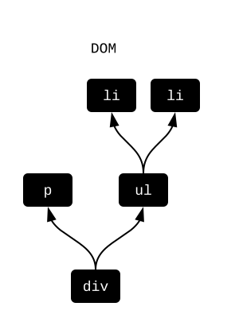

The black boxes represent heavy-weight DOM objects with hundreds of attributes. And when any of them change, it can trigger expensive renders and reflows of page content.


### What is Virtual DOM?

If you are creating an Elm file, you would use `elm/html` to write something like this:

```elm
viewChairAlts : List String -> Html msg
viewChairAlts chairAlts =
  div []
    [ p [] [ text "Chair alternatives include:" ]
    , ul [] (List.map viewAlt chairAlts)
    ]

viewAlt : String -> Html msg
viewAlt chairAlt =
  li [] [ text chairAlt ]
```

You can think of `viewChairAlts ["seiza","chabudai"]` as producing some “Virtual DOM” data structure behind the scenes:

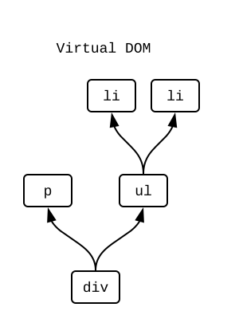

The white boxes represent light-weight JavaScript objects. They only have the attributes you specify. Their creation can never cause renders or reflows. Point is, compared to DOM nodes, these are much cheaper to allocate!


### Render

If we are always working with these virtual nodes in Elm, how does it get converted to the DOM we see on screen? When an Elm program starts, it goes like this:

- Call `init` to get the initial `Model`.
- Call `view` to get the initial virtual nodes.

Now that we have virtual nodes, we make an exact replica in the real DOM:

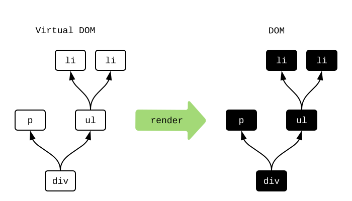

Great! But what about when things change? Redoing the whole DOM on every frame does not work, so what do we do instead?


### Diffing

Once we have the initial DOM, we switch to working primarily with virtual nodes instead. Whenever the `Model` changes, we run `view` again. From there, we “diff” the resulting virtual nodes to figure out how to touch the DOM as little as possible.

So imagine our `Model` gets a new chair alternative, and we want to add a new `li` node for it. Behind the scenes, Elm diffs the **current** virtual nodes and the **next** virtual nodes to detect any changes:

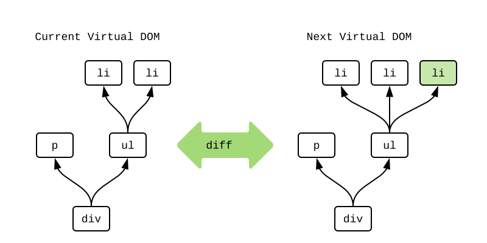

It noticed that a third `li` was added. I marked it in green. Elm now knows exactly how to modify the real DOM to make it match. Just insert that new `li`:

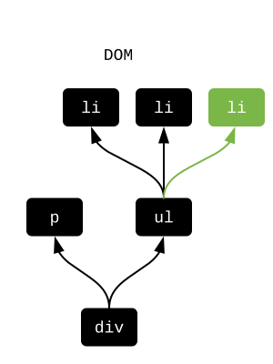

This diffing process makes it possible to touch the DOM as little as possible. And if no differences are found, we do not need to touch the DOM at all! So this process helps minimize the renders and reflows that need to happen.

But can we do even less work?


### `Html.Lazy`

The [`Html.Lazy`](https://package.elm-lang.org/packages/elm/html/latest/Html-Lazy/) module makes it possible to not even build the virtual nodes! The core idea is the `lazy` function:

```elm
lazy : (a -> Html msg) -> a -> Html msg
```

Going back to our chair example, we called `viewChairAlts ["seiza","chabudai"]`, but we could just as easily have called `lazy viewChairAlts ["seiza","chabudai"]` instead. The lazy version allocates a single “lazy” node like this:

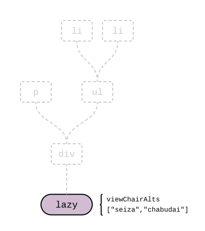

The node just keeps a reference to the function and arguments. Elm can put the function and arguments together to generate the whole structure if needed, but it is not always needed!

One of the cool things about Elm is the “same input, same output” guarantee for functions. So whenever we run into two “lazy” nodes while diffing virtual nodes, we ask is the function the same? Are the arguments the same? If they are all the same, we know the resulting virtual nodes are the same as well! **So we can skip building the virtual nodes entirely!** If any of them have changed, we can build the virtual nodes and do a normal diff.

> **Note:** When are two values “the same” though? To optimize for performance, we use JavaScript’s `===` operator behind the scenes:
>
> - Structural equality is used for `Int`, `Float`, `String`, `Char`, and `Bool`.
> - Reference equality is used for records, lists, custom types, dictionaries, etc.
>
> Structural equality means that `4` is the same as `4` no matter how you produced those values. Reference equality means the actual pointer in memory has to be the same. Using reference equality is always cheap `O(1)`, even when the data structure has thousands or millions of entries. So this is mostly about making sure that using `lazy` will never slow your code down a bunch by accident. All the checks are super cheap!


### Usage

The ideal place to put a lazy node is at the root of your application. Many applications are set up to have distinct visual regions like headers, sidebars, search results, etc. And when people are messing with one, they are very rarely messing with the others. This creates really natural lines for `lazy` calls!

For example, in [my TodoMVC implementation](https://github.com/evancz/elm-todomvc/), the `view` is defined like this:

```elm
view : Model -> Html Msg
view model =
  div
    [ class "todomvc-wrapper"
    , style "visibility" "hidden"
    ]
    [ section
        [ class "todoapp" ]
        [ lazy viewInput model.field
        , lazy2 viewEntries model.visibility model.entries
        , lazy2 viewControls model.visibility model.entries
        ]
    , infoFooter
    ]
```

Notice that the text input, entries, and controls are all in separate lazy nodes. So I can type however many characters I want in the input without ever building virtual nodes for the entries or controls. They are not changing! So the first tip is **try to use lazy nodes at the root of your application.**

It can also be useful to use lazy in long lists of items. In the TodoMVC app, it is all about adding entries to your todo list. You could conceivably have hundreds of entries, but they change very infrequently. This is a great candidate for laziness! By switching `viewEntry entry` to `lazy viewEntry entry` we can skip a bunch of allocation that is very rarely useful. So the second tip is **try to use lazy nodes on repeated structures where each individual item changes infrequently.**


### Summary

Touching the DOM is way more expensive than anything that happens in a normal user interface. Based on my benchmarking, you can do whatever you want with fancy data structures, but in the end it only matters how much you successfully use `lazy`.

On the next page, we will learn a technique to use `lazy` even more!


### `Html.Keyed`

On the previous page, we learned how Virtual DOM works and how we can use `Html.Lazy` to avoid a bunch of work. Now we are going to introduce  [`Html.Keyed`](https://package.elm-lang.org/packages/elm/html/latest/Html-Keyed/) to skip even more work.

This optimization is particularly helpful for lists of data in your interface that must support **insertion**, **removal**, and **reordering**.


### The Problem

Say we have a list of all the Presidents of the United States. And maybe it lets us sort by name, [by education](https://en.wikipedia.org/wiki/List_of_Presidents_of_the_United_States_by_education), [by net worth](https://en.wikipedia.org/wiki/List_of_Presidents_of_the_United_States_by_net_worth), and [by birthplace](https://en.wikipedia.org/wiki/List_of_Presidents_of_the_United_States_by_home_state).

When the diffing algorithm (described on the previous page) gets to a long list of items, it just goes through pairwise:

- Diff the current 1st element with the next 1st element.
- Diff the current 2nd element with the next 2nd element.
- ...

But when you change the sort order, all of these are going to be different! So you end up doing a lot of work on the DOM when you could have just shuffled some nodes around.

This issue exists with insertion and removal as well. Say you remove the 1st of 100 items. Everything is going to be off-by-one and look different. So you get 99 diffs and one removal at the end. No good!


### The Solution

The fix for all of this is [`Html.Keyed.node`](https://package.elm-lang.org/packages/elm/html/latest/Html-Keyed#node), which makes it possible to pair each entry with a “key” that easily distinguishes it from all the others.

So in our presidents example, we could write our code like this:

```elm
import Html exposing (..)
import Html.Keyed as Keyed
import Html.Lazy exposing (lazy)

viewPresidents : List President -> Html msg
viewPresidents presidents =
  Keyed.node "ul" [] (List.map viewKeyedPresident presidents)

viewKeyedPresident : President -> (String, Html msg)
viewKeyedPresident president =
  ( president.name, lazy viewPresident president )

viewPresident : President -> Html msg
viewPresident president =
  li [] [ ... ]
```

Each child node is associated with a key. So instead of doing a pairwise diff, we can diff based on matching keys!

Now the Virtual DOM implementation can recognize when the list is resorted. It first matches all the presidents up by key. Then it diffs those. We used `lazy` for each entry, so we can skip all that work. Nice! It then figures out how to shuffle the DOM nodes to show things in the order you want. So the keyed version does a lot less work in the end.

Resorting helps show how it works, but it is not the most common case that really needs this optimization. **Keyed nodes are extremely important for insertion and removal.** When you remove the 1st of 100 elements, using keyed nodes allows the Virtual DOM implementation to recognize that immediately. So you get a single removal instead of 99 diffs.


### Summary

Touching the DOM is extraordinarily slow compared to the sort of computations that happen in a normal application. **Always reach for `Html.Lazy` and `Html.Keyed` first.** I recommend verifying this with profiling as much as possible. Some browsers provide a timeline view of your program, [like this](https://developers.google.com/web/tools/chrome-devtools/evaluate-performance/reference). It gives you a summary of how much time is spent in loading, scripting, rendering, painting, etc. If you see that 10% of the time is spent scripting, you could make your Elm code twice as fast and not make any noticeable difference. Whereas simple additions of lazy and keyed nodes could start taking big chunks out of that other 90% by touching the DOM less!


### Asset Size

The only thing that is slower than touching the DOM is talking to servers. Especially for folks on mobile phones with slow internet. So you can optimize your code all day with `Html.Lazy` and `Html.Keyed`, but your application will still feel slow if it loads slowly!

A great way to improve is to send fewer bits. For example, if a 122kb asset can become a 9kb asset, it will load faster! We get results like that by using the following techniques:

- **Compilation.** The Elm compiler can perform optimizations like dead code elimination and record field renaming. So it can cut unused code and shorten record field names like `userStatus` in the generated code.
- **Minification.** In the JavaScript world, there are tools called “minifiers” that do a bunch of transformations. They shorten variables. They inline. They convert `if` statements to ternary operators. They turn `'\u0041'` to `'A'`. Anything to save a few bits!
- **Compression.** Once you have gotten the code as small as possible, you can use a compression algorithm like gzip to shrink it even further. It does particularly well with keywords like `function` and `return` that you just cannot get rid of in the code itself.

Elm makes it pretty easy to get all this set up for your project. No need for some complex build system. It is just two terminal commands!


### Instructions

Step one is to compile with the `--optimize` flag. This does things like shortening record field names.

Step two is to minify the resulting JavaScript code. I use a minifier called `uglifyjs`, but you can use a different one if you want. The neat thing about `uglifyjs` is all its special flags. These flags unlock optimizations that are unreliable in normal JS code, but thanks to the design of Elm, they are totally safe for us!

Putting those together, we can optimize `src/Main.elm` with two terminal commands:

```bash
elm make src/Main.elm --optimize --output=elm.js
uglifyjs elm.js --compress 'pure_funcs=[F2,F3,F4,F5,F6,F7,F8,F9,A2,A3,A4,A5,A6,A7,A8,A9],pure_getters,keep_fargs=false,unsafe_comps,unsafe' | uglifyjs --mangle --output elm.min.js
```

After this you will have an `elm.js` and a smaller `elm.min.js` file!

> **Note 1:** `uglifyjs` is called twice there. First to `--compress` and second to `--mangle`. This is necessary! Otherwise `uglifyjs` will ignore our `pure_funcs` flag.
>
> **Note 2:** If the `uglifyjs` command is not available in your terminal, you can run the command `npm install uglify-js --global` to download it. If you do not have `npm` either, you can get it with [nodejs](https://nodejs.org/).


### Scripts

It is hard to remember all those flags for `uglifyjs`, so it is probably better to write a script that does this.

Say we want a bash script that produces `elm.js` and `elm.min.js` files. On Mac or Linux, we can define `optimize.sh` like this:

```bash
#!/bin/sh

set -e

js="elm.js"
min="elm.min.js"

elm make --optimize --output=$js "$@"

uglifyjs $js --compress 'pure_funcs=[F2,F3,F4,F5,F6,F7,F8,F9,A2,A3,A4,A5,A6,A7,A8,A9],pure_getters,keep_fargs=false,unsafe_comps,unsafe' | uglifyjs --mangle --output $min

echo "Compiled size:$(wc $js -c) bytes  ($js)"
echo "Minified size:$(wc $min -c) bytes  ($min)"
echo "Gzipped size: $(gzip $min -c | wc -c) bytes"
```

Now if I run `./optimize.sh src/Main.elm` on my [TodoMVC](https://github.com/evancz/elm-todomvc) code, I see something like this in the terminal:

```text
Compiled size:  122297 bytes  (elm.js)
Minified size:   24123 bytes  (elm.min.js)
Gzipped size:     9148 bytes
```

Pretty neat! We only need to send about 9kb to get this program to people!

The important commands here are `elm` and `uglifyjs` which work on any platform, so it should not be too tough to do something similar on Windows.


### Advice

I recommend writing a `Browser.application` and compiling to a single JavaScript file as we have seen here. It will get downloaded (and cached) when people first visit. Elm creates quite small files compared to the popular competitors, as you can see [here](https://elm-lang.org/blog/small-assets-without-the-headache), so this strategy can take you quite far.

> **Note:** In theory, it is possible to get even smaller assets with Elm. It is not possible right now, but if you are working on 50k lines of Elm or more, we would like to learn about your situation as part of a user study. More details [here](https://gist.github.com/evancz/fc6ff4995395a1643155593a182e2de7)!


## Next Steps

We have a bunch of foundational knowledge now. The next steps are all about gaining experience and building relationships.


### Build Something

Experience is a great teacher, so I recommend building an **application** that interests you. If you do not have something in mind, maybe something like this:

- **Expand Examples** — Take some of the examples from this book and add to them. The code is [here](https://github.com/evancz/elm-architecture-tutorial/)! Mess with [`elm-spa-example`](https://github.com/rtfeldman/elm-spa-example).
- **Something from Work** — Maybe there is something you do at work, and you want to see how it might work in Elm. Try it out on your own and see how it goes! This will set you up well for the advice in [How to Use Elm at Work](https://elm-lang.org/blog/how-to-use-elm-at-work).
- **Data Visualization** — Use a package like [`terezka/line-charts`](https://terezka.github.io/line-charts/) to display data that interests you. I would start with some fake data, but maybe work up to trying to showing data from somewhere else. There is a ton of [economic](https://data.bls.gov/timeseries/LNS11300000) and [health](https://wonder.cdc.gov/) data available that would benefit from better presentation!
- **Games** — I got into programming by making games like pong, breakout, and space invaders. Maybe you will like that sort of thing too! Start by drawing stuff with [`elm/svg`](https://package.elm-lang.org/packages/elm/svg/latest). From there, try responding to events like [`onKeyDown`](https://package.elm-lang.org/packages/elm/browser/latest/Browser-Events#onKeyDown), [`onMouseMove`](https://package.elm-lang.org/packages/elm/browser/latest/Browser-Events#onMouseMove), and [`onAnimationFrame`](https://package.elm-lang.org/packages/elm/browser/latest/Browser-Events#onAnimationFrame). At some point, you can even get into 3D graphics with [`elm-explorations/webgl`](https://package.elm-lang.org/packages/elm-explorations/webgl/latest/)!


### Ask Questions

There are loads of friendly and knowledgeable folks on [Slack](https://elmlang.herokuapp.com/) and [Discourse](https://discourse.elm-lang.org/). Whether you just started programming or have 20 years experience in industry, the #beginners channel on Slack is great for people new to programming in Elm! Maybe you have an error message you are stuck on? Maybe you are struggling to understand JSON decoders? Maybe the `Task` type is tripping you up? Maybe you are curious to get some feedback on a custom type you defined? **Whatever the problem, you can always ask for help!**


### Meet People

There are meetups [all over the world](https://www.meetup.com/topics/elm-programming/all/). We encourage organizers to run [code nights](https://blog.noredink.com/post/142283641812/designing-meetups-to-build-better-communities) where folks can build projects and relationships. The obvious benefit is that you can get help with whatever you are working on, but you also meet everyone else who is using Elm in town. Maybe someone is working on something cool that inspires you. Maybe you learn a technique you did not know you did not know. Maybe someone has a job opening. Maybe knowing a bunch of local Elm programmers will help your case at work. Maybe it is just a fun time. Programmers tend to undervalue the benefits of these personal relationships, but it is one of the most important parts of a healthy programming language community!


## Appendix

### Types as Sets

We have seen primitive types like `Bool` and `String`. We have made our own custom types like this:

```elm
type Color = Red | Yellow | Green
```

One of the most important techniques in Elm programming is to make **the possible values in code** exactly match **the valid values in real life**. This leaves no room for invalid data, and this is why I always encourage folks to focus on custom types and data structures.

In pursuit of this goal, I have found it helpful to understand the relationship between types and sets. It sounds like a stretch, but it really helps develop your mindset!


### Sets

You can think of types as a set of values.

- `Bool` is the set `{ True, False }`
- `Color` is the set `{ Red, Yellow, Green }`
- `Int` is the set `{ ... -2, -1, 0, 1, 2 ... }`
- `Float` is the set `{ ... 0.9, 0.99, 0.999 ... 1.0 ... }`
- `String` is the set `{ "", "a", "aa", "aaa" ... "hello" ... }`

So when you say `x : Bool` it is like saying `x` is in the `{ True, False }` set.


### Cardinality

Some interesting things happen when you start figuring out how many values are in these sets. For example the `Bool` set `{ True, False }` contains two values. So math people would say that `Bool` has a [cardinality](https://en.wikipedia.org/wiki/Cardinality) of two. So conceptually:

- cardinality(`Bool`) = 2
- cardinality(`Color`) = 3
- cardinality(`Int`) = ∞
- cardinality(`Float`) = ∞
- cardinality(`String`) = ∞

This gets more interesting when we start thinking about types like `(Bool, Bool)` that combine sets together.

> **Note:** The cardinality for `Int` and `Float` are actually smaller than infinity. Computers need to fit the numbers into a fixed amount of bits (as described [here](#types-as-bits)) so it is more like cardinality(`Int32`) = 2^32 and cardinality(`Float32`) = 2^32. The point is just that it is a lot.


### Multiplication (Tuples and Records)

When you combine types with tuples, the cardinalities get multiplied:

- cardinality(`(Bool, Bool)`) = cardinality(`Bool`) × cardinality(`Bool`) = 2 × 2 = 4
- cardinality(`(Bool, Color)`) = cardinality(`Bool`) × cardinality(`Color`) = 2 × 3 = 6

To make sure you believe this, try listing all the possible values of `(Bool, Bool)` and `(Bool, Color)`. Do they match the numbers we predicted? How about for `(Color, Color)`?

But what happens when we use infinite sets like `Int` and `String`?

- cardinality(`(Bool, String)`) = 2 × ∞
- cardinality(`(Int, Int)`) = ∞ × ∞

I personally really like the idea of having two infinities. One wasn’t enough? And then seeing infinite infinities. Aren’t we going to run out at some point?

> **Note:** So far we have used tuples, but records work exactly the same way:
>
> - cardinality(`(Bool, Bool)`) = cardinality(`{ x : Bool, y : Bool }`)
> - cardinality(`(Bool, Color)`) = cardinality(`{ active : Bool, color : Color }`)
>
> And if you define `type Point = Point Float Float` then cardinality(`Point`) is equivalent to cardinality(`(Float, Float)`). It is all multiplication!


### Addition (Custom Types)

When figuring out the cardinality of a custom type, you add together the cardinality of each variant. Let’s start by looking at some `Maybe` and `Result` types:

- cardinality(`Result Bool Color`) = cardinality(`Bool`) + cardinality(`Color`) = 2 + 3 = 5
- cardinality(`Maybe Bool`) = 1 + cardinality(`Bool`) = 1 + 2 = 3
- cardinality(`Maybe Int`) = 1 + cardinality(`Int`) = 1 + ∞

To persuade yourself that this is true, try listing out all the possible values in the `Maybe Bool` and `Result Bool Color` sets. Does it match the numbers we got?

Here are some other examples:

```elm
type Height
  = Inches Int
  | Meters Float

-- cardinality(Height)
-- = cardinality(Int) + cardinality(Float)
-- = ∞ + ∞


type Location
  = Nowhere
  | Somewhere Float Float

-- cardinality(Location)
-- = 1 + cardinality((Float, Float))
-- = 1 + cardinality(Float) × cardinality(Float)
-- = 1 + ∞ × ∞
```

Looking at custom types this way helps us see when two types are equivalent. For example, `Location` is equivalent to `Maybe (Float, Float)`. Once you know that, which one should you use? I prefer `Location` for two reasons:

1. The code becomes more self-documenting. No need to wonder if `Just (1.6, 1.8)` is a location or a pair of heights.
2. The `Maybe` module may expose functions that do not make sense for my particular data. For example, combining two locations probably should not work like `Maybe.map2`. Should one `Nowhere` mean that everything is `Nowhere`? Seems weird!

In other words, I write a couple lines of code that are _similar_ to other code, but it gives me a level of clarity and control that is extremely valuable for large code bases and teams.


### Who Cares?

Thinking of “types as sets” helps explain an important class of bugs: **invalid data**. For example, say we want to represent the color of a traffic light. The set of valid values are { red, yellow, green } but how do we represent that in code? Here are three different approaches:

- `type alias Color = String` — We could decide that `"red"`, `"yellow"`, `"green"` are the three strings we will use, and that all the other ones are _invalid data_. But what happens if invalid data is produced? Maybe someone makes a typo like `"rad"`. Maybe someone types `"RED"` instead. Should all functions have checks for incoming color arguments? Should all functions have tests to make sure color results are valid? The root issue is that cardinality(`Color`) = ∞, meaning there are (∞ - 3) invalid values. We will need to do a lot of checking to make sure none of them ever show up!

- `type alias Color = { red : Bool, yellow : Bool, green : Bool }` — The idea here is that the idea of “red” is represented by `Color True False False`. But what about `Color True True True`? What does it mean for it to be all the colors at once? This is _invalid data_. Just like with the `String` representation, we end up writing checks in our code and tests to make sure there are no mistakes. In this case, cardinality(`Color`) = 2 × 2 × 2 = 8, so there are only 5 invalid values. There are definitely fewer ways to mess up, but we should still have some checks and tests.

- `type Color = Red | Yellow | Green` — In this case, invalid data is impossible. cardinality(`Color`) = 1 + 1 + 1 = 3, exactly corresponding to the set of three values in real life. So there is no point checking for invalid color data in our code or tests. It cannot exist!

So the whole point here is that **ruling out invalid data makes your code shorter, simpler, and more reliable.** By making sure the set of _possible_ values in code exactly matches the set of _valid_ values in real life, many problems just go away. This is a sharp knife!

As your program changes, the set of possible values in code may start to diverge from the set of valid values in real life. **I highly recommend revisiting your types periodically to make them match again.** This is like noticing your knife has become dull and sharpening it with a whetstone. This kind of maintenance is a core part of programming in Elm.

**When you start thinking this way, you end up needing fewer tests, yet having more reliable code.** You start using fewer dependencies, yet accomplishing things more quickly. Similarly, someone skilled with a knife probably will not buy a [SlapChop](https://www.slapchop.com/). There is definitely a place for blenders and food processors, but it is smaller than you might think. No one runs ads about how you can be independent and self-sufficient without any serious downsides. No money in that!


> ## Aside on Language Design
>
> Thinking of types as sets like this can also be helpful in explaining why a language would feel “easy” or “restrictive” or “error-prone” to some people. For example:
>
> - **Java** — There are primitive values like `Bool` and `String`. From there, you can create classes with a fixed set of fields of different types. This is much like records in Elm, allowing you to multiply cardinalities. But it is quite difficult to do addition. You can do it with subtyping, but it is quite an elaborate process. So where `Result Bool Color` is easy in Elm, it is pretty tough in Java. I think some people find Java “restrictive” because designing a type with cardinality 5 is quite difficult, often seeming like it is not worth the trouble.
>
> - **JavaScript** — Again, there are primitive values like `Bool` and `String`. From there you can create objects with a dynamic set of fields, allowing you to multiply cardinalities. This is much more lightweight than creating classes. But like Java, doing addition is not particularly easy. For example, you can simulate `Maybe Int` with objects like `{ tag: "just", value: 42 }` and `{ tag: "nothing" }`, but this is really still multiplication of cardinality. This makes it quite difficult to exactly match the set of valid values in real life. So I think people find JavaScript “easy” because designing a type with cardinality (∞ × ∞ × ∞) is super easy and that can cover pretty much anything, but other people find it “error-prone” because designing a type with cardinality 5 is not really possible, leaving lots of space for invalid data.
>
> Interestingly, some imperative languages have custom types! Rust is a great example. They call them [enums](https://doc.rust-lang.org/book/second-edition/ch06-01-defining-an-enum.html) to build on the intuition folks may have from C and Java. So in Rust, addition of cardinalities is just as easy as in Elm, and it brings all the same benefits!
>
> I think the point here is that “addition” of types is extraordinarily underrated in general, and thinking of “types as sets” helps clarify why certain language designs would produce certain frustrations.


### Types as Bits

There are all sorts of types in Elm:

- `Bool`
- `Int`
- `String`
- `(Int, Int)`
- `Maybe Int`
- ...

We have a conceptual understanding of them by now, but how are they understood by a computer? How is `Maybe Int` stored on a hard disk?


### Bits

A **bit** is little box that has two states. Zero or a one. On or off. Computer memory is one super long sequence of bits.

Okay, so all we have is a bunch of bits. Now we need to represent _everything_ with that!


### `Bool`

A `Bool` value can be either `True` or `False`. This corresponds exactly to a bit!


### `Int`

An `Int` value is some whole number like `0`, `1`, `2`, etc. You cannot fit that in a single bit, so the only other option is to use multiple bits. So normally, an `Int` would be a sequence of bits, like these:

```text
00000000
00000001
00000010
00000011
...
```

We can arbitrarily assign meaning to each of these sequences. So maybe `00000000` is zero and `00000001` is one. Great! We can just start assigning numbers to bit sequences in ascending order. But eventually we will run out of bits...

By some quick math, eight bits only allow (2^8 = 256) numbers. What about perfectly reasonable numbers like 9000 and 8004?

The answer is to just add more bits. For a long time, people used 32 bits. That allowed for (2^32 = 4,294,967,296) numbers which covers the kinds of numbers humans typically think about. Computers these days support 64-bit integers, allowing for (2^64 = 18,446,744,073,709,551,616) numbers. That is a lot!

> **Note:** If you are curious how addition works, learn about [two’s complement](https://en.wikipedia.org/wiki/Two%27s_complement). It reveals that numbers are not assigned to bit sequences arbitrarily. For the sake of making addition as fast as possible, this particular way of assigning numbers works really well.


### `String`

The string `"abc"` is the sequence of characters `a` `b` `c`, so we will start by trying to represent characters as bits.

One of the early ways of encoding characters is called [ASCII](https://en.wikipedia.org/wiki/ASCII). Just like with integers, they decided to list out a bunch of bit sequences and start assigning values arbitrarily:

```text
00000000
00000001
00000010
00000011
...
```

So every character needed to fit in eight bits, meaning only 256 characters could be represented! But if you only care about English, this actually works out pretty well. You need to cover 26 lower-case letters, 26 upper-case letters, and 10 numbers. That is 62. There is a bunch of room left for symbols and other weird stuff. You can see what they ended up with [here](https://ascii.cl/).

We have an idea for characters now, but how will the computer know where the `String` ends and the next piece of data begins? It is all just bits. Characters look just like `Int` values really! So we need some way to mark the end.

These days, languages tend to do this by storing the **length** of the string. So a string like `"hello"` might look something like `5` `h` `e` `l` `l` `o` in memory. So you know a `String` always starts with 32-bits representing the length. And whether the length is 0 or 9000, you know exactly where the characters end.

> **Note:** At some point, folks wanted to cover languages besides English. This effort eventually resulted in the [UTF-8](https://en.wikipedia.org/wiki/UTF-8) encoding. It is quite brilliant really, and I encourage you to learn about it. It turns out that “get the 5th character” is harder than it sounds!


### `(Int, Int)`

What about tuples? Well, `(Int, Int)` is two `Int` values, and each one is a sequence of bits. Let’s just put those two sequences next to each other in memory and call it a day!


### Custom Types

A custom type is all about combining different types. Those different types may have all sorts of different shapes. We will start with the `Color` type:

```elm
type Color = Red | Yellow | Green
```

We can assign each case a number: `Red = 0`, `Yellow = 1`, and `Green = 2`. Now we can use the `Int` representation. Here we only need two bits to cover all the possible cases, so `00` is red, `01` is yellow, `10` is green, and `11` is unused.

But what about custom types that hold additional data? Like `Maybe Int`? The typical approach is to set aside some bits to “tag” the data, so we can decide that `Nothing = 0` and `Just = 1`. Here are some examples:

- `Nothing` = `0`
- `Just 12` = `1` `00001100`
- `Just 16` = `1` `00010000`

A `case` expression always looks at that “tag” before deciding what to do next. If it sees a `0` it knows there is no more data. If it sees a `1` it knows it is followed by a sequence of bits representing the data.

This “tag” idea is similar to putting the length at the beginning of `String` values. The values may be different sizes, but the code can always figure out where they start and end.


### Summary

Eventually, all values need to be represented in bits. This page gives a rough overview of how that actually works.

Normally there is no real reason to think about this, but I found it to be helpful in deepening my understanding of custom types and `case` expressions. I hope it is helpful to you as well!

> **Note:** If you think this is interesting, it may be fun to learn more about garbage collection. I have found [The Garbage Collection Handbook](http://gchandbook.org/) to be an excellent resource on the topic!


### Function Types

As you look through packages like [`elm/core`](https://package.elm-lang.org/packages/elm/core/latest/) and [`elm/html`](https://package.elm-lang.org/packages/elm/html/latest/), you will definitely see functions with multiple arrows. For example:

```elm
String.repeat : Int -> String -> String
String.join : String -> List String -> String
```

Why so many arrows? What is going on here?!

### Hidden Parentheses

It starts to become clearer when you see all the parentheses. For example, it is also valid to write the type of `String.repeat` like this:

```elm
String.repeat : Int -> (String -> String)
```

It is a function that takes an `Int` and then produces _another_ function. Let's see this in action:

```elm
String.repeat

String.repeat 4

String.repeat 4 "ha"

String.join

String.join "|"

String.join "|" ["red","yellow","green"]
```
@Elm.repl

So conceptually, **every function accepts one argument.** It may return another function that accepts one argument. Etc. At some point it will stop returning functions.

We _could_ always put the parentheses to indicate that this is what is really happening, but it starts to get pretty unwieldy when you have multiple arguments. It is the same logic behind writing `4 * 2 + 5 * 3` instead of `(4 * 2) + (5 * 3)`. It means there is a bit extra to learn, but it is so common that it is worth it.

Fine, but what is the point of this feature in the first place? Why not do `(Int, String) -> String` and give all the arguments at once?


### Partial Application

It is quite common to use the `List.map` function in Elm programs:

```elm
List.map : (a -> b) -> List a -> List b
```

It takes two arguments: a function and a list. From there it transforms every element in the list with that function. Here are some examples:

- `List.map String.reverse ["part","are"] == ["trap","era"]`
- `List.map String.length ["part","are"] == [4,3]`

Now remember how `String.repeat 4` had type `String -> String` on its own? Well, that means we can say:

- `List.map (String.repeat 2) ["ha","choo"] == ["haha","choochoo"]`

The expression `(String.repeat 2)` is a `String -> String` function, so we can use it directly. No need to say `(\str -> String.repeat 2 str)`.

Elm also uses the convention that **the data structure is always the last argument** across the ecosystem. This means that functions are usually designed with this possible usage in mind, making this a pretty common technique.

Now it is important to remember that **this can be overused!** It is convenient and clear sometimes, but I find it is best used in moderation. So I always recommend breaking out top-level helper functions when things get even a _little_ complicated. That way it has a clear name, the arguments are named, and it is easy to test this new helper function. In our example, that means creating:

```elm
-- List.map reduplicate ["ha","choo"]

reduplicate : String -> String
reduplicate string =
  String.repeat 2 string
```

This case is really simple, but (1) it is now clearer that I am interested in the linguistic phenomenon known as [reduplication](https://en.wikipedia.org/wiki/Reduplication) and (2) it will be quite easy to add new logic to `reduplicate` as my program evolves. Maybe I want [shm-reduplication](https://en.wikipedia.org/wiki/Shm-reduplication) support at some point?

In other words, **if your partial application is getting long, make it a helper function.** And if it is multi-line, it should _definitely_ be turned into a top-level helper! This advice applies to using anonymous functions too.

> **Note:** If you are ending up with “too many” functions when you use this advice, I recommend using comments like `-- REDUPLICATION` to give an overview of the next five or ten functions. Old school! I have shown this with `-- UPDATE` and `-- VIEW` comments in previous examples, but it is a generic technique that I use in all my code. And if you are worried about files getting too long with this advice, I recommend watching [The Life of a File](https://youtu.be/XpDsk374LDE)!


### Pipelines

Elm also has a [pipe operator](https://package.elm-lang.org/packages/elm/core/latest/Basics#%7C%3E) that relies on partial application. For example, say we have a `sanitize` function for turning user input into integers:

```elm
-- BEFORE
sanitize : String -> Maybe Int
sanitize input =
  String.toInt (String.trim input)
```

We can rewrite it like this:

```elm
-- AFTER
sanitize : String -> Maybe Int
sanitize input =
  input
    |> String.trim
    |> String.toInt
```

So in this “pipeline” we pass the input to `String.trim` and then that gets passed along to `String.toInt`.

This is neat because it allows a “left-to-right” reading that many people like, but **pipelines can be overused!** When you have three or four steps, the code often gets clearer if you break out a top-level helper function. Now the transformation has a name. The arguments are named. It has a type annotation. It is much more self-documenting that way, and your teammates and your future self will appreciate it! Testing the logic gets easier too.

> **Note:** I personally prefer the `BEFORE`, but perhaps that is just because I learned functional programming in languages without pipes!


## License and Source

This course is the official Elm guide **An Introduction to Elm** by **Evan Czaplicki**, converted to LiaScript.

* Original: https://guide.elm-lang.org/
* Source: [github.com/evancz/guide.elm-lang.org](https://github.com/evancz/guide.elm-lang.org/tree/57567579ae4b3f75906c50d9e410c69504e29638) at commit `5756757`
* License: [Creative Commons Attribution-NonCommercial-NoDerivatives 4.0 International (CC BY-NC-ND 4.0)](https://creativecommons.org/licenses/by-nc-nd/4.0/)

Converted to LiaScript format; the text is unchanged. Only the format was changed: the interactive REPL boxes and the example programs run directly in the browser with the template [elm-guida](https://github.com/LiaTemplates/elm-guida), which compiles with Elm 0.19.1 (the guide itself refers to Elm 0.19.3). Images and the video are taken from the original repository.
